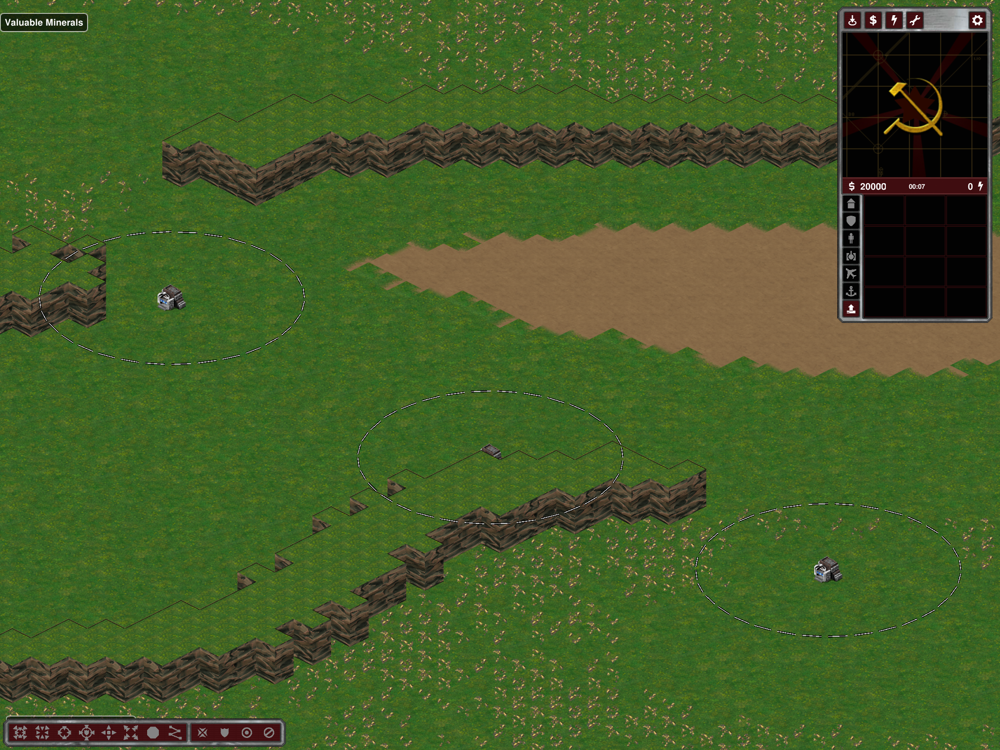
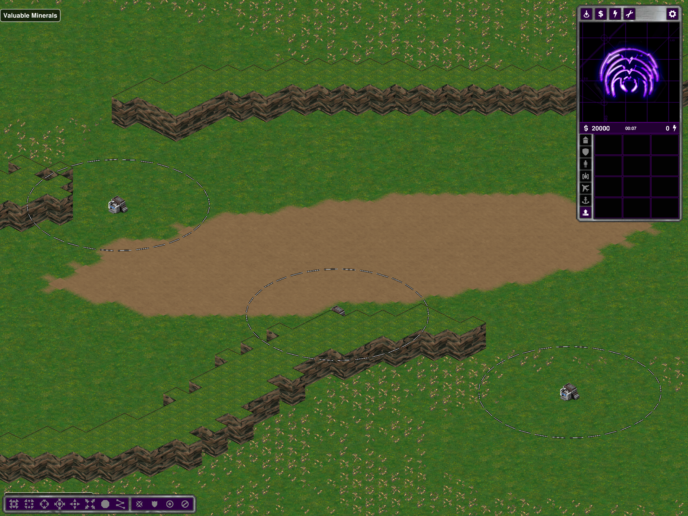
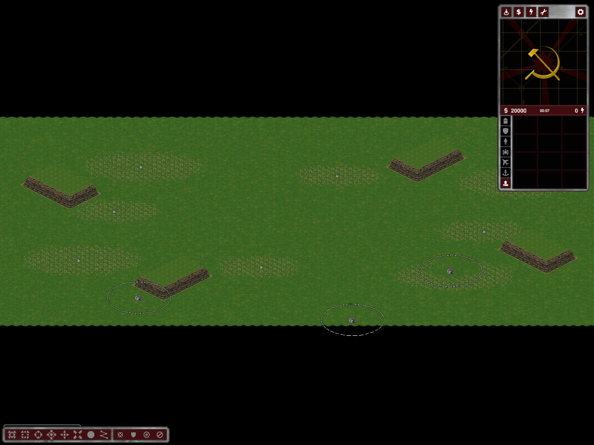
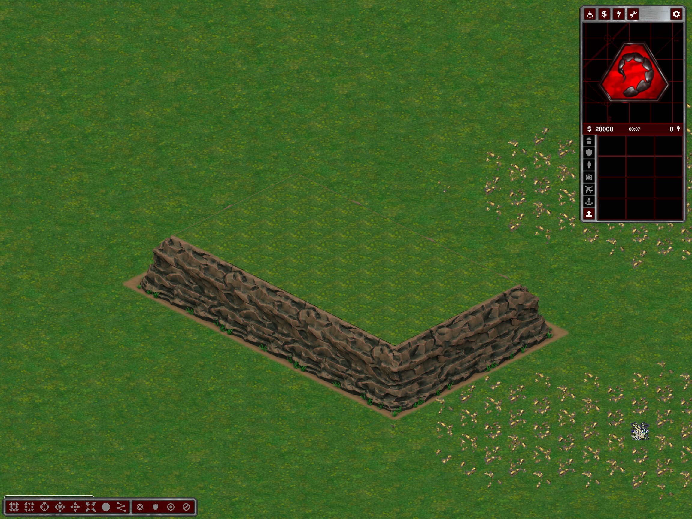

# Arabia, Hill Fortress and small transition fringes

User maps: Strategic Hill Fortress 4P/117327894 and Strategic Arabia 4P/811863718.

## Hill Fortress

The center feature was already between the teams, but the exporter's seed-phased noise kept only its right-hand portion. Hill Fortress now paints a compact, centered (0.65-radius) copy of that feature. Other presets keep their existing dirt-placement policy.

The saved user map's heights, resources, mountain tiles and complete actor YAML remain byte-identical after regeneration. The dirt material itself moves/changes area (232 to 324 dirt cells in this case); it still has ordinary Dirt terrain speeds, not artificially changed locomotors. No hill/ramp/cliff geometry was edited.

Old rectangular Grass-A/Dirt-Light and Grass-A/Dirt-Dark transition IDs are no longer exported. Saved maps retain their IDs and collision but render those Clear cells as Grass A. Pure grass/light-or-dark-dirt joins use the original authored silhouettes, as sand joins already do; multi-material junctions keep the existing blend. Grass-B legacy autotile families are outside this narrowly scoped normalization.

## Arabia

Rotationally repeated bent lines could intersect into hooked arms and leave narrow passages. Arabia's mountain option now creates disjoint, straight native-grid rectangular rock islands, with no joined/bent roof components and a reserved open center. Rejected whole proposals do not delete resources or paint over existing obstacles.

- At least six ground cells separate reserved cliff feet and map boundaries/other rock footprints.
- Every home has a route to the center in terrain eroded by a two-cell native square: five-cell-wide corridor clearance, not mere point connectivity.
- The shared closed height-four cliff family reserves complete feet before commitment. Export requires every raised component to remain closed; legacy mountain-wall and fallback wall pieces are prohibited by regression checks.
- Rock roofs and feet remain blocked. This is a new, more open obstacle layout, not a cosmetic overlay on the old hooked layout. It does not change Hill Fortress mountains or other presets' mountain planning.

## Small fringes

A ground overlay can turn almost transparent authored shore tails opaque. Ground-overlay exclusions now also protect shore alpha 1–16 where coverage is lower than the full source diamond. Broad authored gradients and uncut land/land diamond antialiasing remain intact. Source RGBA, shoreline selection, terrain, coast actors and collision are unchanged.

The first experiment excluded *all* partial shore alpha. Actual screenshots exposed a sand wedge at a three-material junction, so that experiment was rejected; only the narrowly limited tail cleanup remains. This is not a claim that every visible transition fringe is gone.

## Checks and evidence

- Release build succeeded in an isolated binary directory while the user's game was running; subsequently installed with a successful normal Release build after the game closed. No user-owned process was terminated.
- `--arabia-layout-test OUTPUT`: twelve twice-generated Strategic layouts and exports, 2/3/4/8/12/16 players, seeds 42 and 811863718. Rectangular disjoint components, blocked roofs/feet, clearance, five-cell routes, deterministic terrain/economy and closed-only export checked.
- Actual Arabia client: all twelve autonomous objective visits completed by tick 2919. This is routing acceptance, not a complete victory/fairness match.
- `--hill-dirt-test OUTPUT`: six exports, 3/4/8 players, seeds 42 and 117327894; dirt centroid within one map cell of the center, no old dirt transitions. All 48 supported legacy IDs' variants preserve Clear terrain in both tilesets.
- `--rubberduck-shore-art`: 1880 compositions, 47 topologies, ten material/lighting blocks; original RGBA and exact clipping coverage checked.
- Actual shaded shore editor: brush refresh, exact Undo/Redo, save/reload and full dual-water cache passed. Cache: 864 ground + 1152 water + 15 apron frames, five 2048² sheets / 80 MiB full capacity. This supersedes the earlier 704-ground-frame count without increasing the complete atlas bound.
- Installed-client Hill Fortress, Arabia overview and close-up inspected. Normal Two Sides tail-cleanup capture inspected; rejected broad-clipping images are not acceptance.

Evidence: `%TEMP%/ymca-hill-dirt`, `%TEMP%/ymca-arabia-feedback`, `%TEMP%/ymca-transition-fringe`, with result-pointer files and utility/client logs. The isolated support directory links existing content read-only in practice (no content writes were performed); it has its own logs/settings/screenshots. Temporary playable fixtures were moved out of the repository's map list after tests.

No all-seed/all-custom-option visual guarantee, new long soak, or multiplayer balance claim. Restart; regenerate Hill Fortress for the centered patch and Arabia for the new obstacle topology. Legacy transition rendering and the tail cleanup also apply to old saved layouts. Changes are uncommitted/unpushed.
