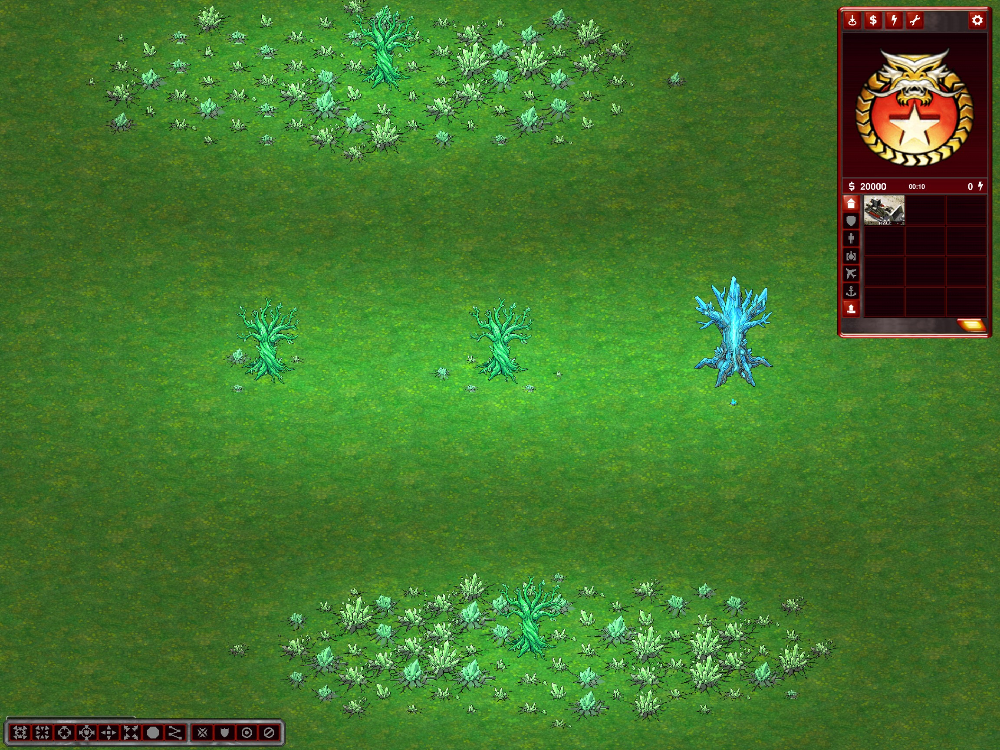

# Authored green and blue Tiberium trees

The supplied original artwork is now used on normal and shaded Rubberduck:

- `green tib tree.png`: SHA256 `c7aa5de3848169040c659cfeeb8db218bec94d27c48c3d49cb8233d8a138589d`, 10,456 nontransparent pixels.
- `blue tib tree.png`: SHA256 `95eabcc221bb7740ddc2f210484c474bb5d51cb33e5cddf28d7a7bc5b00f2b53`, 19,694 nontransparent pixels.

Both 256x256 source files remain unchanged. Runtime PNGs preserve every RGBA pixel, without resizing, cropping, recoloring, generated glow or added shadow. The green ground anchor is (128,184); blue is (128,223). PNG offsets compensate the old sequence offsets so these source anchors land at the actor's ground position.

## Integration

- `SPLIT2` and `SPLIT3`: green artwork.
- `SPLITBLUE`: blue artwork through a new `splitblue` sequence alias inheriting `split3`.
- Non-Rubberduck tilesets retain their previous tree sprite filenames through sequence inheritance.
- Existing actor types, 1x1 footprints, resource types, seed intervals (55 green / 110 blue), make/idle timing and terrain-light traits are unchanged.
- These are **static single-image trees**, not newly authored animations. Fifty-five logical PNG frames reference the same full image using supported `Frame[N]` metadata. This preserves the existing make frames 0–29, active frames 30–53 and idle frame 54 without a physically repeated 55-image atlas.
- The existing tree lighting is retained, including its shared green/blue tint settings; this change does not retune tree-light colors.

## Reproduction and validation

Outputs are under `mods/ca/bits/resources/tiberium-trees/`. From `Game`, with external `tsx`, `pngjs` and Node types available:

```text
node <dependencies>/tsx/dist/cli.mjs tools/prepare-tiberium-trees.ts .. mods/ca/bits/resources/tiberium-trees
```

The tool pins both input hashes. Independent pixel checks confirm exact source RGBA equality for all three runtime variants, 55 valid logical regions per variant, and compensated ground anchors. TypeScript ES2022/Node16 checking passed. Actual normal/shaded clients displayed all three actor types; green and blue resources appeared around the corresponding test trees. Evidence: `%TEMP%/ymca-tiberium-trees`.

Game and editor share these sequences. No fresh full editor lifecycle, harvesting/income, network or performance certification. No executable rebuild or map regeneration is needed: restart/reload to refresh cached sprites and rules.


