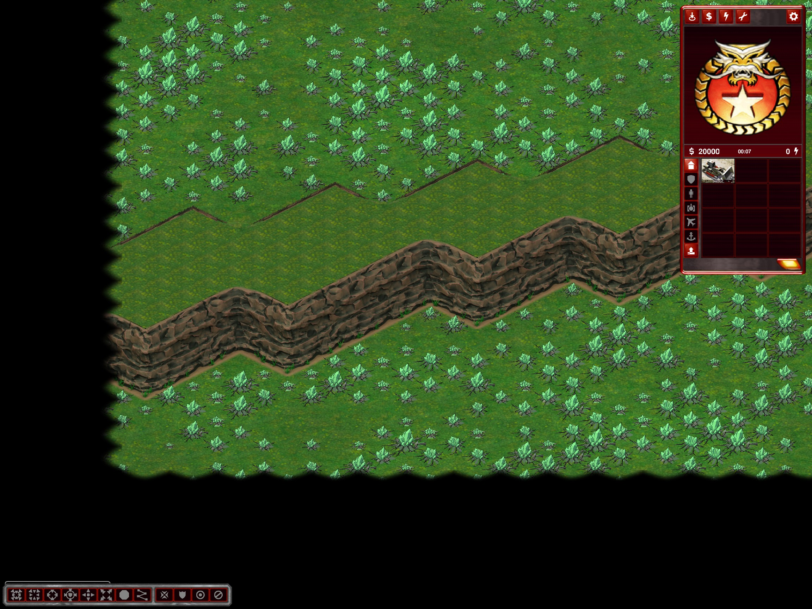

# Battle Nexus walls continue outside the playable map

Battle Nexus rock layouts now use a 16-cell backing margin on all sides, following the existing Hill Fortress approach. Closed wall ends are planned beyond the playable boundary instead of at the visible edge. The requested playable width/height, center-radius calculation and spawn projection retain their previous dimensions. Players cannot use the backing to bypass the central entrances.

Only the rock variant is padded. Custom River Nexus keeps its previous unpadded layout. Home patches must fit inside playable bounds, and Glitter is generated only there; the backing carries no resources, generators, tech buildings or spawns.

Checks under `%TEMP%/ymca-nexus-offmap`:

- 22 plan cases: Tactical/Operational, 2/3/4/8/12/16 players, seeds 42/43 except 16P43. New assertions verify every visible connected rock roof extends over eight cells beyond the playable boundary and that no economy is placed outside it. Existing entrance/isolation and gameplay validations also run.
- Rock Nexus and River Nexus 4P42 full exports passed canonical comparison. Rock Nexus export bounds remain 96x96 despite the additional backing.
- Twelve Nexus center exports passed Dirt and resource parity checks: both modes, seeds 42/43, Glitter/Patches/None.
- Actual client capture of a wall crossing the left playable boundary confirms it continues beneath the map-edge mask without a visible end cap.
- **Known limitation:** 16P43 fails the 32-attempt generation limit on both the prior installed binary and the modified build. This preexisting seed failure is excluded from the 22 passing cases, not treated as fixed.

No fresh all-seed, performance, network, shaded-client or editor lifecycle certification. Existing packages are unchanged: restart after installation and regenerate.

