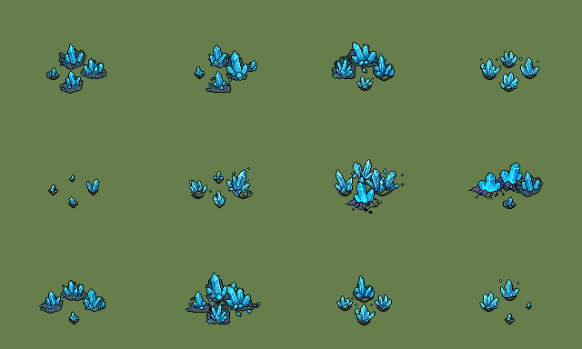
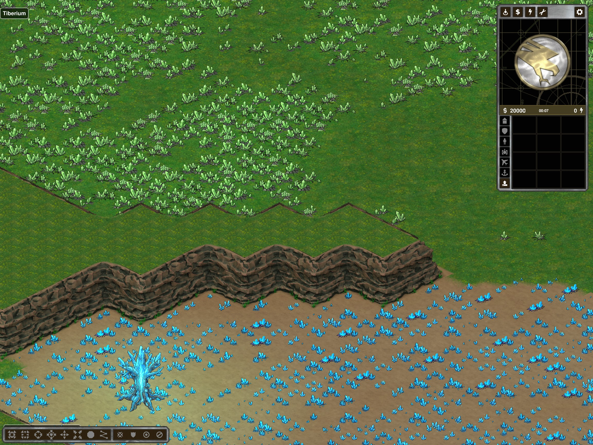

# Small blue Tiberium clusters

The transparent cutouts from five `isometric_scattered_...` scenes (the initial two were user-reviewed) are retained unchanged under `mods/ca/bits/resources/blue-crystal-clusters/source/`, together with their source-coordinate manifest. The review folder outside Game remains untouched.

## Selection

Eleven small scene groups are used: A-01, A-02, A-03, A-04, A-05, A-06, A-08, A-09, A-11, B-01, B-05. A-07, A-10, B-02, B-03, B-04 and B-06 remain source-only. Three existing motifs (legacy blue 4,6,8) are retained; legacy 1,2,3,5,7 are excluded.

Following review, B-03 and legacy 2 were also removed: their tips reached 30 and 32 pixels above the ground anchor, respectively, the two tallest remaining silhouettes. Existing source/body PNGs remain available, but no layout references them.

Three additional scenes (C/D/E) were then extracted, adding **16 small motifs**: C-01,02,03,04,07; D-01,02,03,04,05; E-01,04,06,07,09,11. Larger groups remain excluded, including C-06 which exceeds the retained 26-pixel tip-height ceiling. E-05 is cliff-occluded and is not used. The new scenes use a stricter blue-color mask to remove cyan-lit terrain; original A/B cutouts remain byte-identical.

**Thirty small motifs** (27 scene motifs plus three legacy motifs) form twelve bounded arrangements. All are represented across the 48 motif slots. Native sizes, original colors and alpha are preserved. Source cutouts originate from opaque scenes: their reviewed masks, including any incomplete/occluded edges, are not reconstructed or repainted. No new glow or shadows are baked in.

## Density

As with [green clusters](green-crystal-clusters.md), each cell displays one, two, three or four small motifs as density rises. Each state occupies three of the twelve logical frames. Motif positions stay fixed while density changes; there is no size scaling. Full depletion and regrowth can select a new arrangement through the existing renderer.

The twelve `resources.btiN` slots reference 160x128 frames with anchor (80,80) and PNG offset (0,-16), on normal and shaded Rubberduck only. Old small bodies retain their pixel sizes when translated from their former 192x192 frames. Compositing is done offline: one resource sprite per cell, not extra actors or per-motif renderables.

Resource amounts, prices, growth/harvesting, terrain lights, trees, green art and other tilesets are unchanged. Existing maps update on reload; no regeneration is needed.

## Reproduction and validation

From Game, with external tsx/pngjs:

```text
node <dependencies>/tsx/dist/cli.mjs tools/prepare-blue-crystal-clusters.ts mods/ca/bits/resources
```

The top-level `extracted-blue-tiberium/START-HIER.html` and `UEBERSICHT.png` show all 45 extracted groups, including unused large ones. `Game/tools/extract-scene-blue-crystals.ts` reproduces this review extraction when run from the YMCA top-level folder; approved/imported cutouts are copied into `source/` before composing runtime atlases.

`layouts.json` records source hashes, source-coordinate anchors, fixed positions and all motif choices. Independent Pillow checks confirm unchanged reviewed pixels, reconstruct all 144 density frames within one alpha-compositing rounding unit, and check fixed size/position, bounded output, monotonic alpha coverage, metadata, all thirty motifs and excluded groups. TypeScript ES2022/Node16 checking passed.

Actual normal/shaded clients displayed the new blue carpet alongside green fields and the blue tree. Evidence: `%TEMP%/ymca-blue-clusters`. These are scoped asset/runtime checks, not full harvesting, network, editor-lifecycle or performance certification.



