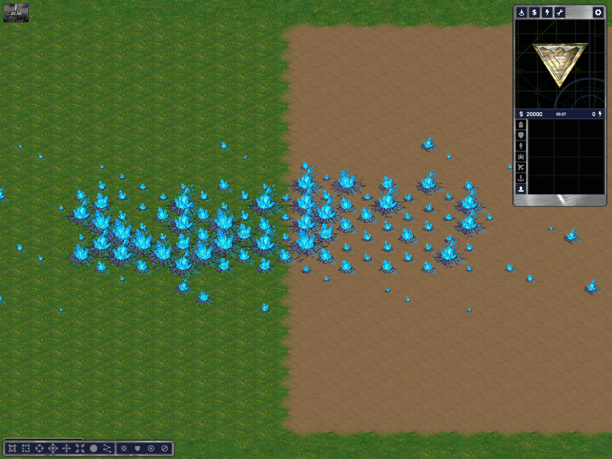

# Authored blue Tiberium sprites

Source `../8 blue crystals.png` remains unchanged, SHA256 `dd8e640795b0ffb3e6b3a3ed94815c847df2b7884c111319b3b34d0644e0afa1`.

Reproduce using external tsx/pngjs dependencies (same tools environment as `green-crystals.md`), from the repository parent:

```sh
node /tmp/ymca-crystal-node/node_modules/tsx/dist/cli.mjs Game/tools/extract-blue-crystals.ts '8 blue crystals.png' Game/mods/ca/bits/resources/blue-crystals
```

`NODE_PATH` must point to the external node_modules directory. No repository dependencies are installed.

The output directory contains eight separate combined motifs, `-body.png`, `-glow.png`, `-growth.png`, `preview.png` and provenance. The two large source motifs touch through dark ground/crack pixels; their connected component is separated along `2*y=x+110`. Detached cyan shards belong to the nearest large motif; remaining detached cracks to the nearest main motif. All 21,676 visible source pixels are accounted for once: 15,904 original body RGBA pixels preserved, 5,772 flat navy ground pixels replaced with a softened blue RGBA overlay `(35,166,255)`, alpha at most 100/255. This separate glow image is now only a diagnostic reference. Runtime combined/growth PNGs contain the body only; [dynamic terrain lighting](tiberium-terrain-light.md) replaces the baked-in glow.

Each 192x192 frame has anchor (96,112), PNG offset (0,-16). Twelve nearest-neighbor density frames scale 45–100%; these are not twelve hand-drawn stages. Existing `bti1..bti12` slots cycle through eight motifs (1–4 consequently occur twice), only for RUBBERDUCK-TEMPERATE and RUBBERDUCK-TEMPERATE-SHADED. Green crystals, other tilesets, resource values, density rules, growth, blue trees and map packages are unchanged.

Validation: TypeScript typecheck; extractor's pixel accounting/source-hash/margin checks; all eight PNG metadata/alpha/full-density-frame checks; real normal and shaded clients showing blue crystals on grass and Dirt. Evidence `%TEMP%/ymca-blue-crystals`. This is a sprite replacement, not a new economy or harvesting certification. Existing maps receive the sprites when reloaded in a restarted client; regeneration is unnecessary.


