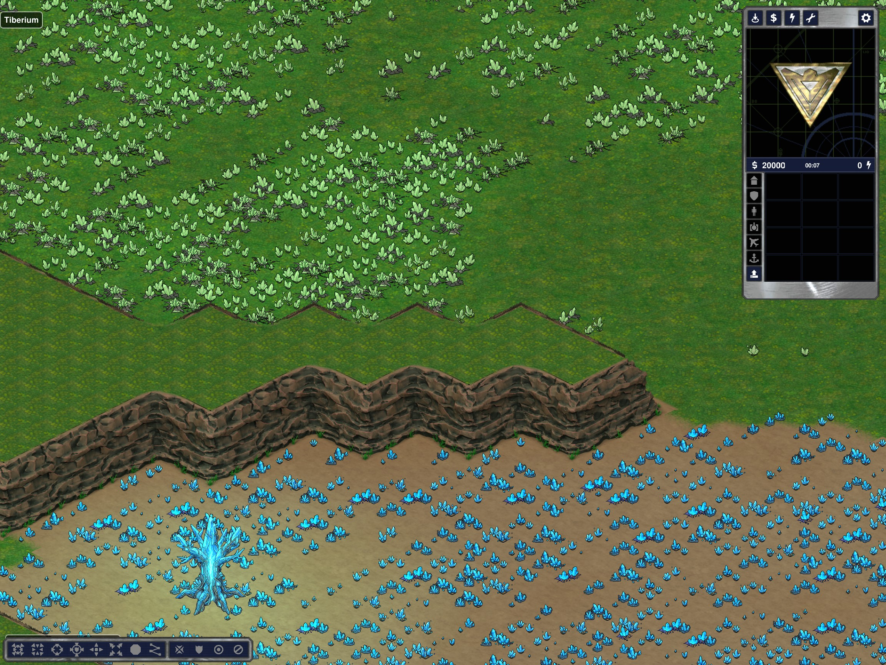

# Broken-earth bases for previously bare crystals

Small earth/stone rims have been added to **14 green scene motifs** and **19 blue
motifs**. Existing soil-bearing green sheets, blue legacy 4/6/8 and scene groups
A-01, A-03, A-04, A-05, A-08, A-09, A-11 and B-01 retain their original bases.
The active pools remain 26 green / 30 blue.

`tools/crystal-earth.ts` contains four small native-pixel broken-earth stamps.
These are newly authored additions, not pixels extracted from the source images.
Their muted dark-gray/olive palette follows the older soil-bearing green artwork.
Open centers and separate wedges avoid a solid rectangular platform. A stamp is
selected by the lower crystal footprint and placed at its visible root, ignoring
isolated lower specks. No crystal scaling or repositioning occurs.

Only previously transparent pixels receive earth; existing foreground RGBA and
antialiasing are preserved. The original source and palette-normalized files are
kept separately. `grounded-*-body.png` stores additions before the thin-contour
pass; `earthBodies` in each layout manifest identifies the modified motifs.
The common outline helper then preserves dark edges and adds only missing
one-pixel cardinal contour segments, before density compositing.

Validation: both TypeScript helper tests and type checking pass; all 33 added
bases preserve original foreground pixels; all 288 runtime frames independently
reconstructed and bounded, with monotonic alpha coverage; layouts and motif
counts unchanged. Normal/shaded captures reviewed. Evidence:
`%TEMP%/ymca-crystal-earth`.

Resource amounts, harvesting, growth, collision, terrain lighting and trees are
unchanged. Restart/reload suffices; no map regeneration or rebuild is needed.

