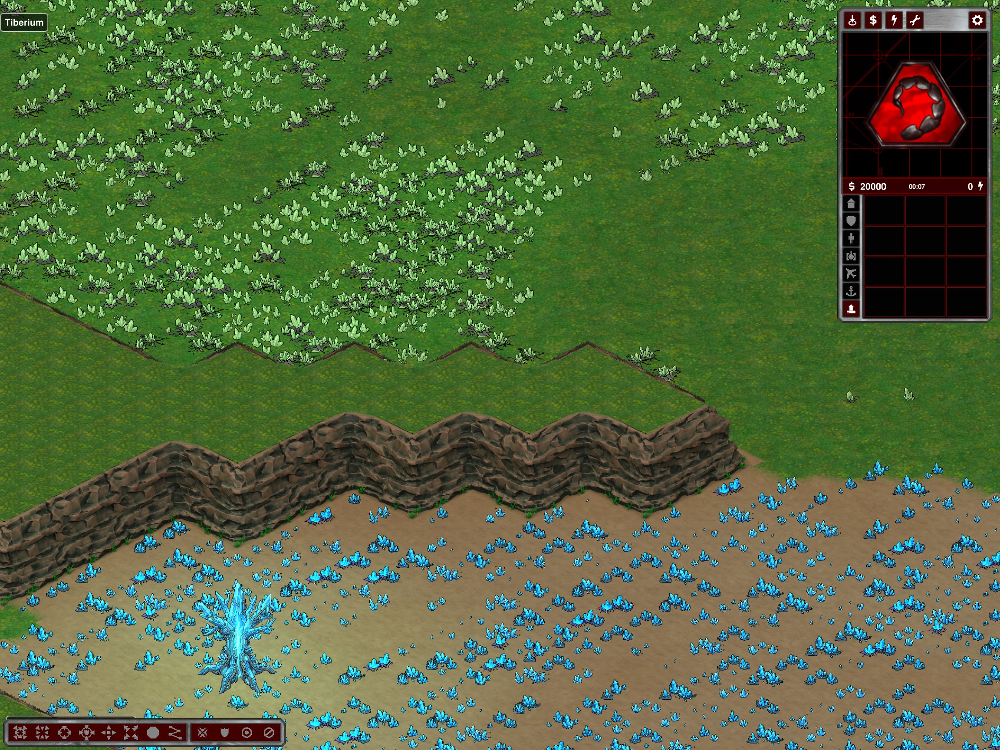

# Thin black crystal outlines

All 26 green and 30 blue resource motifs now receive **only missing** one-pixel
contour segments. The previous unconditional eight-neighbor dilation was too
thick: it added a second layer around already outlined source artwork.

`tools/crystal-outlines.ts` now skips existing dark source pixels (maximum RGB
channel <= 96 and weighted luma `(299*r + 587*g + 114*b)/1000 <= 64`). This includes
near-black green/blue lines and dark gray, not only exact black. Only transparent
cardinal neighbors of remaining colored pixels receive new opaque black pixels;
diagonal corners are not padded. Existing RGBA pixels are never modified. The
pass is idempotent, so running it on already outlined art cannot thicken it again.
Authored interior lines are not thinned or redrawn.

Each motif is outlined before back-to-front density compositing. Layouts,
anchors, density counts, atlas metadata, palette colors and source bodies remain
unchanged. The sprite can extend one extra pixel at previously unoutlined edges,
still inside its frame. Collision, resources, harvesting, lights and trees are
unchanged. Final bodies remain `outlined-*-body.png`, referenced by `outlineBodies`
in each `layouts.json`; both generators use the same helper.

Validation:
- `tools/test-crystal-outlines.ts`: cardinal-only outline, existing black/tinted
  outline preservation, repeat-pass idempotence, source/alpha preservation and
  clipping guard.
- TypeScript checking; all 56 bodies independently reproduced; all 288 atlas frames
  independently reconstructed with monotonic alpha coverage through density states.
- Newly added pixels reduced from 5606 to 1369 for green (75.6% fewer), and 3790 to
  1041 for blue (72.5% fewer), compared with the initial thick pass.
- Normal and shaded client captures completed. Evidence:
  `%TEMP%/ymca-crystal-thin-outlines`.

