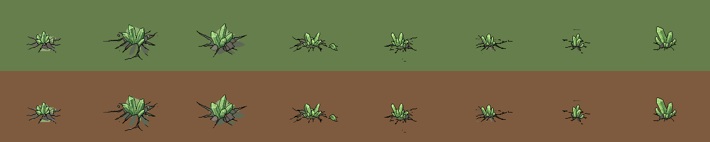
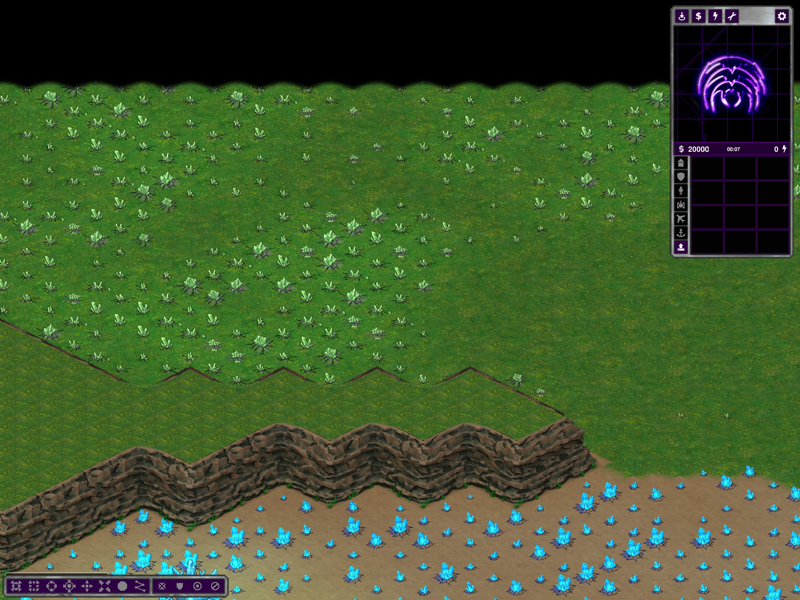

# Crystal size selection and green color harmony

The green runtime selection and density behavior below are superseded by [small crystal clusters](green-crystal-clusters.md): fourteen small motifs arranged by density, without scaling. The blue exclusions and source-preservation policy remain current.

On normal and shaded Rubberduck, the largest crystal clusters are removed from the runtime selection, not scaled down:

- Original four-green sheet: exclude motif **2**.
- New seven-green sheet: exclude motifs **4 and 6**.
- Blue sheet: exclude motifs **3 and 5**.

Eight distinct green and six distinct blue motifs remain. All twelve `ti` and twelve `bti` sequence names remain valid; excluded slots reuse retained motifs. Each blue motif appears twice; green repeats favor the smaller new motifs. Resources are not removed from maps. Existing sizes and twelve density frames remain unchanged for retained motifs.

## Color harmonization

The retained original green motifs (1,3,4) now use derived PNGs under `bits/resources/green-crystals-harmonized/`. `tools/harmonize-green-crystals.ts` shifts their cool green hues by -28 degrees toward the new set's yellow-green palette. The selective mask requires green-dominant RGB, hue 100–170 degrees, maximum channel at least 40 and chroma at least 15. Neutral stones, brown cracks, transparency and near-black outlines are untouched. HSL lightness and saturation are retained (integer rounding only); no geometry, density scaling or glow changes are applied.

The new green motifs retain their supplied colors. Blue colors, all trees, terrain lighting, economy rules and other tilesets are unchanged. Authored sources and original extraction outputs are preserved; excluded motifs remain available as source assets.

From `Game`, with external `tsx`/`pngjs` dependencies:

```text
node <dependencies>/tsx/dist/cli.mjs tools/harmonize-green-crystals.ts mods/ca/bits/resources
```

## Validation

- TypeScript ES2022/Node16 checking passed.
- Independent pixel checks: unchanged alpha/size, preserved RGB minimum/maximum (HSL lightness/saturation), expected hue rotation, exact final-frame/body equality and twelve-frame metadata.
- All 24 sequence slots resolve on both Rubberduck tilesets; eight green/six blue distinct motifs; no excluded motif references.
- Actual normal and shaded clients loaded the revised green/blue fields. Evidence: `%TEMP%/ymca-crystal-harmony`.
- This is scoped visual/asset validation, not new harvesting, network, editor lifecycle or performance certification.

Restart/reload refreshes the cached art. Existing maps need no regeneration or executable rebuild.



