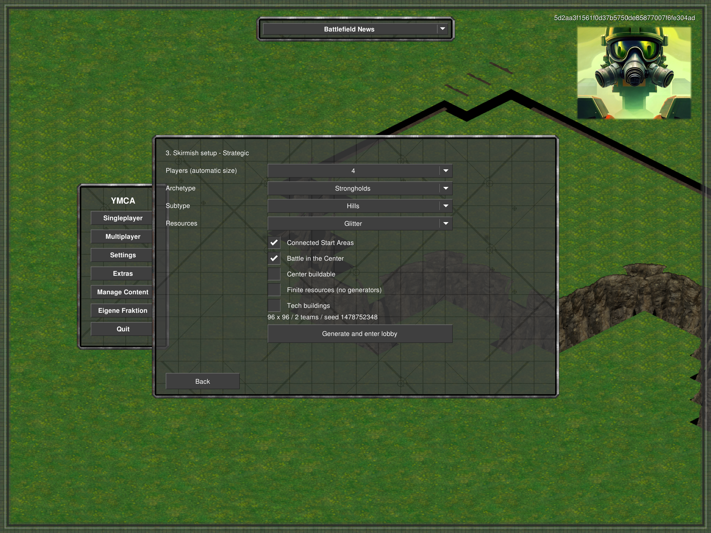
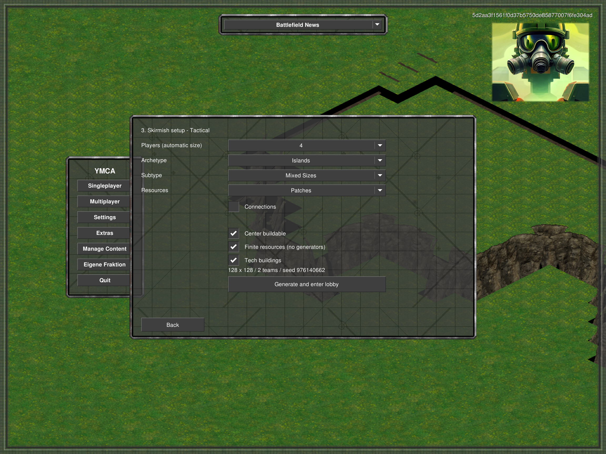

# Customize: topology, subtypes and independent switches

Customize no longer offers a preset selector or a Mountain Valleys archetype. The three UI archetypes are Strongholds, Open Plains and Islands. Existing preset cards still dispatch to their original generators; the new settings object is absent on that path.

## Matrix

| Archetype/subtype | Connected Start Areas | Battle in the Center | Generator/path |
|---|---|---|---|
| Strongholds / Hills | on | on | Hill Fortress, one wide ramp per team roof |
| Strongholds / Hills | on | off | Same plateau planner, two wide ramps per team roof; no central Dirt |
| Strongholds / Hills | off | on | Battle Nexus |
| Strongholds / Hills | off | off | Mountain Valleys |
| Strongholds / River | on | on | Two Sides, its existing river/causeway/bank topology |
| Strongholds / River | on | off | Two dry team regions, narrower river, three distributed destructible bridges, no rock banks |
| Strongholds / River | off | on | Battle Nexus's radial sectors/gates, with water replacing mountain dividers |
| Strongholds / River | off | off | Intersecting rivers, separate land patches, spread-out player starts and a bridge network; no rock banks |
| Open Plains / Flat | — | — | Open-plains generator without mountains or basins |
| Open Plains / Rocky | — | — | Plains |
| Open Plains / Ponds | — | — | Water Basins |
| Islands / Small Islands | — | — | Archipelago island generation; Connections off omits **all** bridges, including team bridges |
| Islands / Big Islands | — | — | Continents; Connections on retains its existing paired bridges, off omits them |
| Islands / Mixed Sizes | — | — | Migration; optional bridges |

Canonical combinations reuse the real generators, not approximate replicas. Tests compare their starts, physical terrain, bridge count and planned resource/tech placements against the corresponding uncustomized generator. Explicit center-ground choices and the separately approved resource conversion below intentionally affect exported tiles/resource IDs.

`Connections` on builds protected-bank links, including a genuine cross-team route, not just team links. A native-axis forest does not promise that every small oil island is reachable by land: protected islands can still require transport. No economy is erased and no sea is filled to force bridge sockets. Invalid candidates retry as complete layouts.

`Center buildable` appears only for defined centers. Strongholds with Battle Center default to non-buildable Dirt; Mixed Sizes defaults to a buildable central island. The user can override either. Bridge structures and their reserved abutments remain exceptions to building placement. Turning Battle Center off removes central Dirt, not resources. Changing Strongholds/Open Plains geometry preserves independently selected economy settings and seed. Customize puts player count first. All island subtypes now expose None/Glitter/Patches as well; the old explanatory island-economy label has been removed. The resource choice survives island subtype/connection changes. None removes Tiberium and its generators, while tech structures remain. Glitter spreads over eligible home land for Small/Big Islands; Patches retains their existing deposits. Mixed Sizes keeps resources on the central island: Glitter retains its dense field, Patches creates separated radial deposits. Build areas, shore clearance, bridge approaches and tech footprints remain protected. Finite resources and Tech buildings are now available on every island subtype too. Finite removes generators; disabling it adds central Tiberium trees for Mixed Sizes. Disabling tech removes neutral tech actors without removing their islands. These choices survive subtype/connection changes; choosing None forces finite resources. Initial defaults remain subtype-specific (Small/Big regenerating, Mixed finite); preset-card generation is unchanged. All dropdowns precede all checkboxes.

New river-patch maps reserve radius-nine starting build disks and bridge banks before placing economy. Automatic dimensions allow at least 36 cells per patch axis. Strategic objectives are reserved on existing dry ground before economy; objective placement must not flatten bridge water or delete resources. Existing Strategic compatibility restrictions remain.

## Tiberium migration (separate from topology)

- Generated ordinary/rich resources export green/blue Tiberium (indices 3/4); generated mines become trees. Battle Nexus's central generators are blue trees.
- Both Tiberium types are allowed on Dirt in game and editor. Building permissions remain Clear/Road.
- Legacy map indices 1/2 normalize to 3/4 in memory. Legacy `mine`/`gmine` actor IDs remain valid aliases for green/blue trees, but are hidden from the editor actor picker. Opening a map does not rewrite its package; explicitly saving in the editor stores the normalized resources.
- Runtime normalization happens before resource loading. Editor normalization happens after its valuation/render listeners initialize, through normal cell-change events. An initial early-editor normalization crash was diagnosed and corrected; the subsequent editor run passed.
- The shared resource layers/picker and harvester resource lists now use Tiberium only. Existing Tiberium prices, density rules and tree growth intervals are used: this is **not** a balance-neutral cosmetic recolor. Arbitrary map-local rules or campaign scripts that explicitly spawn Ore/Gems need separate auditing.

## Evidence and limits

`%TEMP%/ymca-customize` contains staged builds, exports, logs and client captures. The base matrix covers all 17 topology combinations at 4P42, plus both ground policies for six center combinations. Additional new-geometry cases cover 2P43 and 8P42; final river layouts also cover 16P43. New river and open-valley Strategic exports pass protected-objective checks. Interrupted batch runs are not counted as complete; remaining cases were run independently.

Actual UI checks cover the new controls, conditional center visibility, Back/chooser behavior, existing preset cards and same-server Change Map. Live open-valley tests complete eight infantry/tank ascent/descent probes over all four ramps (last descent tick 998), plus roof MCV deployment. Five river-network and six island-network bridges complete real crossing/layering, destruction and subsequent ship passage tests. Native and legacy-resource Nexus clients load 506 unoccupied blue-resource cells, extract both Tiberium types on Dirt and check blue-tree replenishment and non-buildable depleted ground. The legacy-map editor passes corner refresh, Undo/Redo and terrain/resource/actor save/reload.

The final installed Release build has zero errors and three existing warnings; Modular tests pass 180/180, selection checks pass 1816 concrete actor definitions, and the contour suite passes 180 contours/543 corrupt rejections. Only this task's diagnostic map packages were moved back to its temp fixtures directory.

These are scoped generation/runtime checks, not all-seed fairness, campaign compatibility, multiplayer synchronization or performance certification. No engine changes or original artwork changes are required.

Island-resource follow-up: 54 plan checks cover three subtypes × two bridge settings × three resource choices at 4P42, 2P43 and 8P42. Twelve Glitter cases were repeated after adding coastal clearance; six representative combinations were exported (both affected Glitter exports repeated afterward). Default Continents/Migration paths still pass canonical comparisons. The real UI probe selects all three resource choices on every island subtype, checks player-count ordering and absence of the old explanation; 180 Modular tests pass. Evidence: `%TEMP%/ymca-island-resource-options`.

Finite/tech follow-up (`%TEMP%/ymca-island-economy-options`): 60 plan combinations at 4P42 cover all island subtypes, bridge choices, resource choices, finite/infinite and tech on/off (None always finite). Two additional 8P43 infinite-Migration cases pass. Four exports verify actual actor counts: Small/Big finite+no-tech contain zero trees/oils; infinite Mixed contains four trees with tech enabled (28 oils) or disabled (zero oils). Default Continents/Migration canonical comparisons and real UI toggling pass; Modular tests pass 180/180. These checks do not constitute new long-running resource-growth or balance certification.

