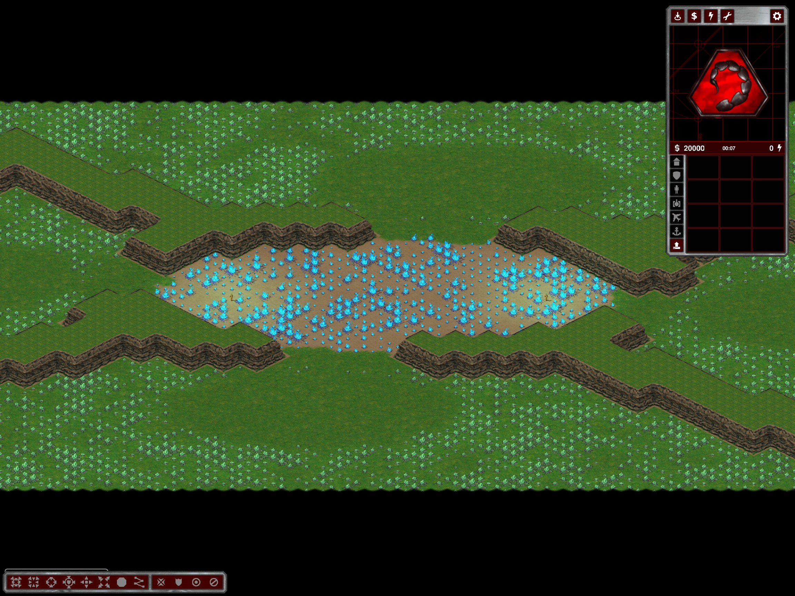

# Wider in-game zoom-out

`ExtendedWorldZoom` on `World` unlocks a minimum scale of one third of the normal player zoom-out limit through the existing engine viewport API. This shows three times the width and height (approximately nine times the area), without changing the starting camera scale or the maximum zoom-in.

Observers use the same new limit; the observer UI cannot subsequently narrow it back to its previous two-times-normal limit. The editor retains its existing, wider four-times-normal range. Diagnostic maps can still explicitly request a wider range. Resolution/viewport-preset recalculation uses the engine's existing relative-scale handling.

This is a local camera-only trait: no sight, fog, targeting, collision or simulation rules change. No engine patch or new engine pin is needed. With the current depth-buffer-disabled mod configuration, the existing renderer limits framebuffer size; a wider view still draws more terrain/actors and is not performance-free.

Validation: actual player and observer clients on the same Nexus fixture passed initial-scale and zoom-clamp checks. Observed normal minimum 0.75, new minimum 0.25, unchanged maximum 4.8. The runtime assertions live behind `TerrainCalibrationView.ValidateExtendedZoom`, used only in the owned diagnostic fixture. Evidence: `%TEMP%/ymca-extended-zoom`, dedicated probe log `db631383c68231f662cf13fc6dbd44be7a850e065018485caf2d5265df42fe3d.log`.

No fresh all-resolution, input-device, network, fog or large-battle performance certification. Restart/reload the map after installation; existing maps do not need regeneration.

