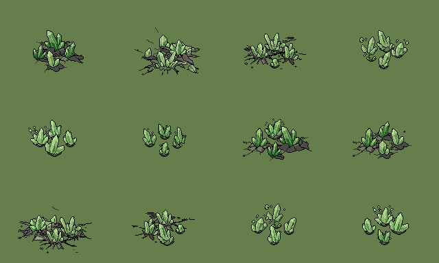
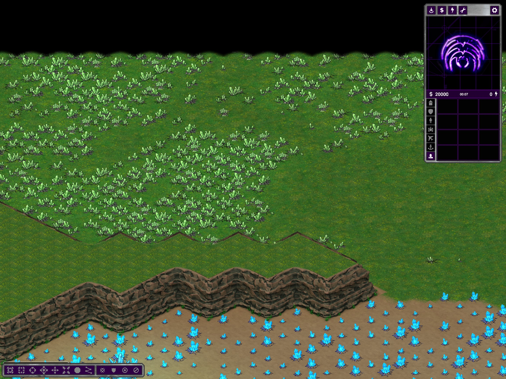

# Small green crystals: density by count, not scale

Current rendering applies a [shared earthy legacy palette](green-crystal-palette.md) to every active green motif, superseding the separate sheet-level colors described below.

Current height review: **26 active green motifs** (blue: 30). Eleven-sheet motif 6 and seven-sheet motif 7 are now excluded: their tips extended 33 and 32 pixels above the ground anchor, the two tallest remaining silhouettes. Source assets are retained; the density layout still uses 1–4 unscaled small groups per cell.

Source: repository-root `11 green crystals.png`, unchanged, SHA256 `199747faee651337d408fc8f3e994a3a7c51735e3d773444ebddab178185704f`.

`tools/prepare-green-crystal-clusters.ts` extracts all eleven motifs losslessly. The eleven raw bodies reconstruct all **13,286 nontransparent source pixels** exactly once, including detached fragments assigned to the nearest main body. Native foot anchors and the source hash are recorded in `bits/resources/green-crystal-clusters/provenance.txt`.

## Runtime selection and colors

The new sheet's three large motifs (5, 7, 8 in extraction order: center, lower left, lower right) are excluded. Eight small motifs join six existing small motifs: harmonized original-green 1 and seven-green 1,2,3,5,7. The previous medium-sized original-green 3/4 also leave the runtime selection. Initially fourteen small motifs were used across twelve arrangements. The [three additional green collections](green-scene-crystals.md) now contribute fourteen more small motifs: 28 motifs before the latest height review, now **26 active green motifs** across the same twelve arrangements. Large scene clusters remain excluded.

Only derived runtime copies of the new green crystal colors are harmonized: green-dominant hues 100–170 degrees map to `95 + (hue - 120) * 0.35`. HSL lightness/saturation and alpha are retained apart from integer rounding; neutral stones, brown cracks and near-black outlines stay unchanged. Raw extractions preserve the exact original colors. No scaling, new glow, shadows or painted detail is added.

## Density behavior

Each of the twelve existing `resources.tiN` slots uses a twelve-frame atlas:

| Frames | Small motifs per cell |
| --- | --- |
| 0–2 | 1 |
| 3–5 | 2 |
| 6–8 | 3 |
| 9–11 | 4 |

The normal resource renderer still maps resource density to frame index. Each arrangement is a nested sequence: motifs are added at fixed positions, never enlarged or shuffled. On depletion, the most recently added motifs disappear first. While density remains positive, the renderer retains the same variant. Complete depletion followed by regrowth may choose a new variant, as before; no engine behavior was changed.

The four positions relative to the cell anchor are `(0,-10)`, `(-22,2)`, `(22,2)`, `(0,16)`, in back-to-front compositing order. Each chosen body must fit within the cell's 128-pixel horizontal span and no farther than 32 pixels below the ground anchor. Vertical crystal tips may extend upward. Individual source shapes and colors are retained; overlap uses source-over alpha. `layouts.json` records every choice, making extraction/composition reproducible. Adjacent dense cells form a lower, fuller carpet rather than isolated oversized pillars.

There is still one resource sprite per cell, not four actors/renderables. Quantities, prices, growth, harvesting, collision, fog and terrain-light rules are unchanged. Game and editor share the sequence definitions. Normal and shaded Rubberduck use the same atlases. Blue now uses the equivalent [thirty-motif cluster implementation](blue-crystal-clusters.md); the trees and other tilesets are untouched.

## Reproduction and checks

From `Game`, with external `tsx`/`pngjs` and existing extraction outputs:

```text
node <dependencies>/tsx/dist/cli.mjs tools/prepare-green-crystal-clusters.ts "../11 green crystals.png" mods/ca/bits/resources
```

- TypeScript ES2022/Node16 checking passed.
- Independent Pillow checks reconstruct the original source exactly.
- All 144 atlas frames independently recomposed from `layouts.json`, matching within one alpha-compositing rounding unit; unscaled motifs and fixed positions verified.
- Four distinct density states per arrangement, monotonic alpha coverage, bounds, metadata and use of all original fourteen small motifs verified; see the additional-collection checks for the current 28-motif pool.
- Normal/shaded clients displayed revised fields, with unchanged blue fields alongside. Evidence: `%TEMP%/ymca-green-clusters`.

Scoped asset/runtime validation, not a fresh full harvesting, multiplayer, editor-lifecycle or performance certification. Restart/reload is sufficient; existing maps need no regeneration or executable rebuild.



