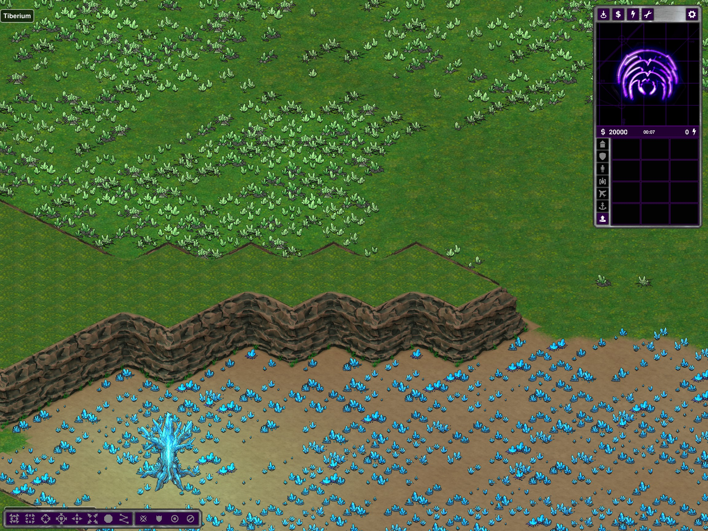

# Targeted green fringe and washed-out facet correction

Affected: eleven-sheet motifs 1–4, all four scene-B motifs and all five scene-C
motifs (13 total). Eleven-9 and the other twelve green motifs remain byte-identical.
Blue, trees, originals and intermediate extraction files are unchanged.

The previous per-motif histogram match lifted dark authored green edges into
lighter colors. Its broad green mask also admitted muted olive-gray earth colors,
which contributed to the washed-out appearance. This was a color-processing issue,
not an extra terrain-light effect.

`repair-green-crystal-contrast.ts` replaces that histogram pass only for the
specified motifs. It excludes muted olive-gray colors, matches actual green faces
to saturated shades from the existing reference palette using their source
lightness with a gentle 0.85 compression, and turns exposed dark green boundary
pixels black in place. Broad highlight clipping is avoided to retain facet detail.
No alpha is changed in this color pass and no new contour layer is added. The
existing thin-outline helper recognizes those dark edges rather than expanding
them; earth placement and density arrangements are unchanged.

Validation: helper regression test and TypeScript check; 13 targeted outputs;
unchanged palette alpha; unaffected green bodies, blue assets, trees and source
files checked against pre-change SHA256 hashes; 144 runtime frames independently
reconstructed with monotonic density alpha. Normal and shaded runtime captures
completed. Evidence: `%TEMP%/ymca-green-fringe`.

