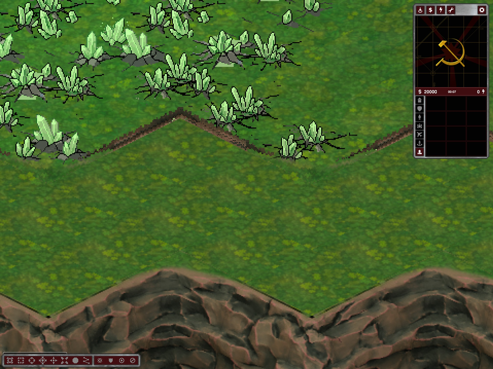

# Unified green palette from the earthy legacy crystals

Update: [targeted fringe/contrast correction](green-crystal-fringe-fix.md) replaces the histogram pass for eleven-1 through 4 and all scene-B/C motifs. The rest retain the palette processing documented below.

All **26 active green motifs** now use one common authored green palette in the final runtime atlas. The reference is the existing in-game soil-bearing motif `bits/resources/green-crystals-harmonized/green-crystal-1-body.png`. This preserves its current appearance rather than reverting to the cooler colors of the original source sheet.

`tools/prepare-green-crystal-clusters.ts` extracts fourteen green shades from this reference. For each other motif it matches the distribution of crystal-face lightness to that reference, preserving shade ordering, and uses the corresponding reference RGB colors. Matching only hue was insufficient: the newest scenes still looked substantially brighter. This final pass also aligns brightness and saturation with the old earthy artwork.

The mask covers green-dominant pixels with maximum channel at least 40, chroma at least 15 and hue 70–170 degrees. Neutral soil, rocks, brown cracks, near-black outlines, alpha, positions and pixel sizes remain unchanged. The reference motif itself is byte-identical. No dirt is added to motifs that originally had none, and no glow is baked in. Blue resources and trees are untouched.

The raw artwork and intermediate extraction files remain unchanged. Final runtime bodies are saved as `green-crystal-clusters/palette-*-body.png`. `layouts.json` records the reference path/hash, exact palette and final body paths alongside the unchanged density-compositing scheme. This final palette pass supersedes the earlier per-sheet hue shifts and scene saturation cap for displayed sprites; those intermediate outputs remain reproducible.

Validation: all recolored green pixels belong to the reference palette; nonmasked pixels and alpha are unchanged; shade ordering is monotonic; all 144 atlas frames independently reconstructed from the final bodies within one alpha-compositing rounding unit. TypeScript checking and normal/shaded client captures passed. Evidence: `%TEMP%/ymca-green-palette`.

Counts remain 26 green / 30 blue. Density remains 1–4 small groups per cell, with no size scaling or economy changes. Restart/reload is sufficient; no map regeneration or executable rebuild is required.

