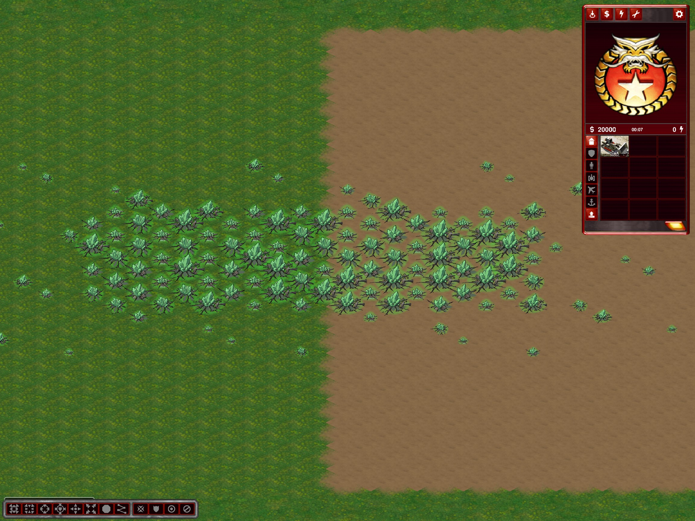

# Authored green Tiberium crystals

Source: repository-root `4 green crystals.png`, unchanged; SHA256 `da601479ead4435d0ae3cd96539bb19d2b0e201f218ab2acaceb93ab6e2d2918`.

Outputs in `mods/ca/bits/resources/green-crystals/`:

- `green-crystal-1.png` through `green-crystal-4.png`: individually extracted RGBA motifs, **without baked-in glow**.
- `*-body.png` / `*-glow.png`: authored solid motif and the old green alpha overlay retained only as a diagnostic reference (unused in-game).
- `*-growth.png`: twelve nearest-neighbor size stages per motif, from 45% to full size. These are generated density stages, not additional hand-drawn growth artwork.
- `preview.png`: composites over grass-colored, dirt-colored and dark backgrounds.
- `provenance.txt`: source hash and extraction counts.

The four large connected components and adjacent detached crack pixels are retained. Twelve isolated stray pixels are omitted. Only the original flat olive ground color and its near-identical palette variants are removed. Authored crystal, stone and crack colors remain intact (8,978 pixels). The removed ground mask (6,961 pixels) is softened with three box filters and becomes RGB (76,226,63), alpha up to 100/255. That separate diagnostic overlay is no longer composited into runtime PNGs. The game now supplies [dynamic terrain lighting](tiberium-terrain-light.md).

The 160x128 frames share a foot anchor at (80,80); PNG frame metadata supplies offset (0,-16). Existing `resources.ti1` through `ti12` map cyclically to the four atlases on Rubberduck normal and shaded tilesets, maintaining equal variant frequency. Other tilesets, blue Tiberium, trees, quantities, prices and harvesting rules are untouched. Game and editor use the shared resource sequences. Existing maps receive the visual change on reload; regeneration is unnecessary.

## Reproduction

Requires Node, `tsx` and `pngjs` (installed outside the repository during development). From `Game`, with `NODE_PATH` pointing at that dependency directory:

```text
node <dependencies>/tsx/dist/cli.mjs tools/extract-green-crystals.ts "../4 green crystals.png" mods/ca/bits/resources/green-crystals
```

The extraction tool type-checks with TypeScript targeting ES2022/Node16. Pixel checks cover all four layers, bounded nonbinary glow alpha, 48 density frames and exact full-size frame parity; the original file hash is verified unchanged.

Actual client captures on normal and shaded Rubberduck show sparse/dense green fields spanning grass and Dirt. This is visual/runtime coverage, not a new harvesting or editor Undo/Redo certification. Evidence: `%TEMP%/ymca-green-crystals`; only the two owned diagnostic map packages were moved back into its fixtures directory after testing. No executable rebuild is needed for these asset/sequence changes.


