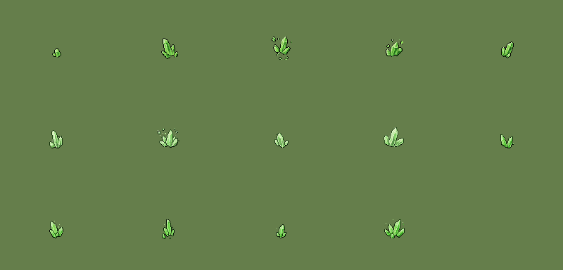
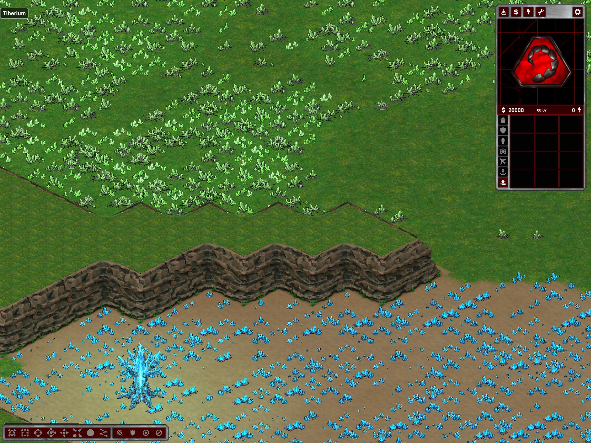

# Three additional green collections: small motifs only

The final runtime atlas now uses the [shared earthy legacy palette](green-crystal-palette.md). The per-scene harmonization below remains an intermediate extraction step, not the final displayed palette.

Sources are preserved unchanged under `mods/ca/bits/resources/green-scene-crystals/source/`, matching the repository-root files:

- A: `isometric_scattered_...-193181616-0.png` — five small groups.
- B: `isometric_scattered_...-581459725-0.png` — four small groups.
- C: `isometric_scattered_...-180869324-0.png` — five small groups.

The large clusters are intentionally not extracted into the runtime pool. Fourteen new small groups initially joined fourteen existing green motifs. A subsequent height review excludes eleven-sheet motif 6 and seven-sheet motif 7, leaving **26 active green motifs**. All fourteen scene groups remain included. Blue remains at 30. The same twelve green sequence slots and four nested density states (1–4 small motifs) are retained, without resizing. Layout selection prioritizes unused motifs so every selected small motif is represented, including bodies restricted to center positions by their width.

## Extraction and palette

`tools/extract-scene-green-crystals.ts` uses manually selected source regions, a green-color mask, retained original dark edge pixels and enclosed-shade filling to remove the rocky platforms. `*-raw.png` retains source RGBA exactly for every included pixel; no missing artwork is invented. `manifest.json` records source hashes, regions, native foot anchors and retained pixel counts. New tips extend no more than 28 pixels above their ground anchor.

`*-body.png` is the harmonized runtime version: green hues are mapped to the existing yellow-green family, and saturation is capped at 0.62 to avoid neon patches among the older pastel-green motifs. HSL lightness, alpha, silhouette and native size remain unchanged apart from integer color rounding. Neutral/dark pixels are not recolored. Original PNGs and raw cutouts remain untouched.

From Game, with external tsx/pngjs:

```text
node <dependencies>/tsx/dist/cli.mjs tools/extract-scene-green-crystals.ts mods/ca/bits/resources/green-scene-crystals
node <dependencies>/tsx/dist/cli.mjs tools/prepare-green-crystal-clusters.ts "../11 green crystals.png" mods/ca/bits/resources
```

## Validation

- All fourteen raw cutouts checked against their original source coordinates: exact retained RGBA, source hashes unchanged, no overlapping extractions.
- Final palette checked for preserved alpha/lightness and the saturation cap.
- All 144 green atlas frames independently reconstructed from unscaled bodies and fixed layout positions, within one alpha-compositing rounding unit; bounds and monotonic coverage verified.
- TypeScript checking passed; actual normal/shaded clients displayed the final green and blue fields.
- Evidence: `%TEMP%/ymca-green-more`. Scoped art/runtime coverage, not fresh harvesting, multiplayer, editor lifecycle or performance certification.

No economy, light, tree, collision or other-tileset changes. Restart/reload suffices; maps do not need regeneration.



