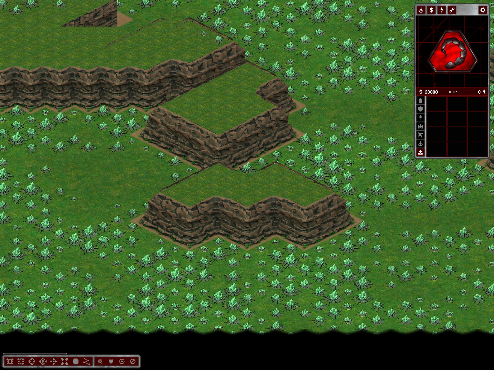
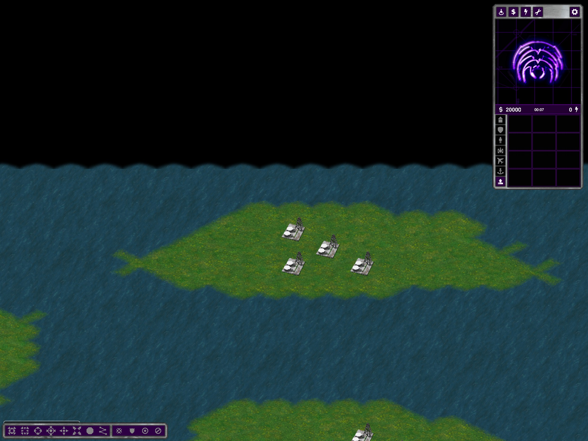
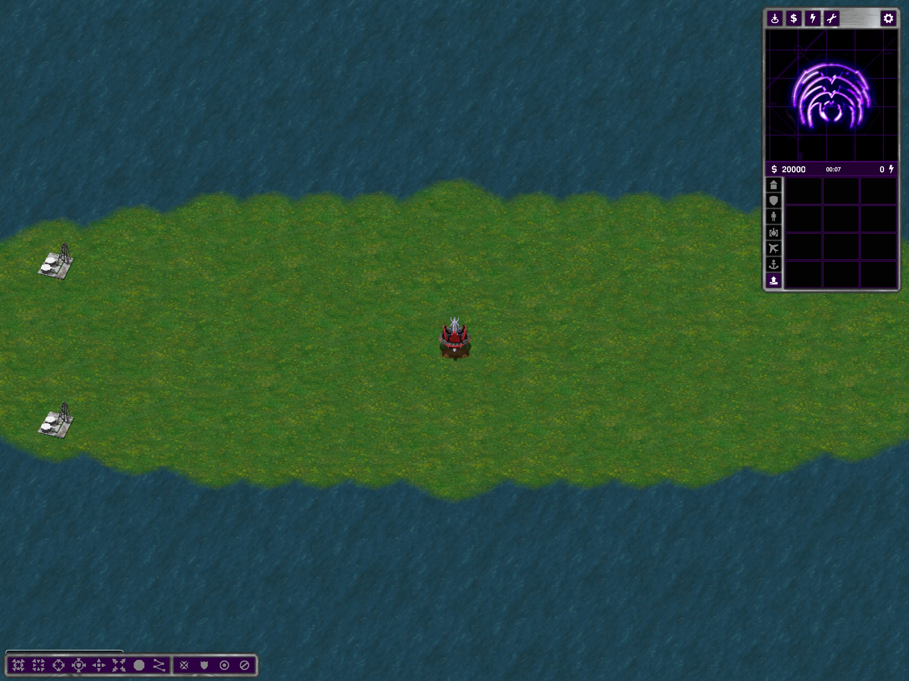

# Closed expansion walls, dry oil foundations and open Archipelago shores

## Mountain Valleys

Expansion walls no longer use the legacy mountain-wall rendering path. `ClosedExpansionRimPlanner` proposes native 2x2 roof runs, reserves complete closed-contour feet, and commits only validated components. Gates, a 5x5 native-cell expansion center, existing terrain/features and Strategic reservations remain protected. The raw curved proposal may be replanned into separate complete rock segments around protected passages; it is not clipped into unsupported wall ends.

Expansion-site search now tries the complete wall plan on a clone before accepting a site. All previously reachable cells that remain traversable must still be reachable, including the expansion center. Failed proposals leave no partial walls. Export explicitly rejects any Mountain Valleys mountain terrain not covered by the planned surfaces, preventing accidental legacy-renderer fallback. The same contour composition is already used by the editor and home plateaus. Home roofs/ramps remain economy-free.

Initial strict whole-raw-rim rejection failed Strategic 4P42. Replanning complete closed segments around the reserved front fixed that case; the final suite below was rerun. This is a topology change and can move expansion sites, not just replace textures on old maps.

## Oil derricks on islands

All island derricks must have their entire native 2x2 foundation **plus one land cell on every side and corner** on dry terrain, without bridge or cliff-shore cells. Final plan validation repeats that check after smoothing/connections. Cluster placement tries four phases of a two-cell lattice, preventing foundation overlaps and retaining the requested count; impossible clusters reject the layout instead of silently dropping buildings. Migration home pairs also require this margin while retaining their build-disk and launch-shore exclusions.

Neutral Archipelago oil-island radii are now 6–7 rather than 4–7 to accommodate four to six buildings. Automatic Archipelago dimensions have a minimum of 96x96: the former 80x80 three-player layout failed with safely sized neutral islands. This also raises automatic two-player maps to 96x96. Explicitly undersized CLI layouts can still be rejected. Migration home-island radii and the two starting derricks per enabled home are unchanged. Tech buildings off still removes the buildings.

## Archipelago / Custom Small Islands

The coast policy now selects open shores, like Migration and Water Basins. No rock-coast actors or blocked coast tiles are generated; the old collision is not merely made invisible. Landing reservations and the original same-team / optional custom bridge policies remain. Follow-up: Continents / Custom Big Islands now also use this open-shore policy. All three island subtypes reject rock-coast actors and blocked coast tiles in the custom export regression. Two Sides retains its separate continuous-bank policy.

## Validation and limitations

- `%TEMP%/ymca-closed-expansion`: 24 Strategic cases (2–12 and 16 players, seeds 42/43), each generated twice, plus protected-route transaction controls; 16 Tactical/Operational plans across 2/4/8/16 players and seeds 42/43. Actual 4P1493471248 and Strategic 8P43 exports reject legacy mountain-wall actors. Actual client view of the new expansion contours captured.
- `%TEMP%/ymca-dry-oil`: 30 island plans (all three subtypes, connections off/on, 2/4/8/16-player coverage plus 8P43), six representative 4P42 exports and two 16P43 exports with independent native footprint/margin and overlap checks. Four additional 2/3-player Small Islands checks after the minimum-size adjustment; a 3P43 tech-off Glitter export and a Mixed Sizes no-resource/no-tech plan passed.
- Original Archipelago preset suite: **31 twice-generated exports passed**, checking team separation, bridge counts, protected banks, real-water crossings and absence of coast actors/blockers. The first run timed out after 27 cases; the remaining four completed separately using `skip=27`, including the protected-bank negative control. The earlier pre-size-adjustment run failed at 3P and is not counted as a pass.
- Actual client views show dry Migration home/islet foundations and an open-shore Archipelago oil island. Modular tests: 180/180.
- No fresh all-seed balance, WAN, large-map performance, actual naval travel or editor Undo/Redo/save/reload certification. Shared closed-cliff material seams remain a separate concern.

Continents follow-up validation: eight full exports (Big Islands connections off/on, 2/4/8/16 players, seed 42) passed resource, dry oil margin, bridge/canonical checks and the no-coast-actor/no-blocked-coast-tile assertions. Logs: `%TEMP%/ymca-continents-open`. Standard binaries installed after checking that no OpenRA process was running; build had zero errors and three existing warnings. No fresh visual or naval runtime certification for this follow-up.

Restart and regenerate maps. Existing map packages are not rewritten.

