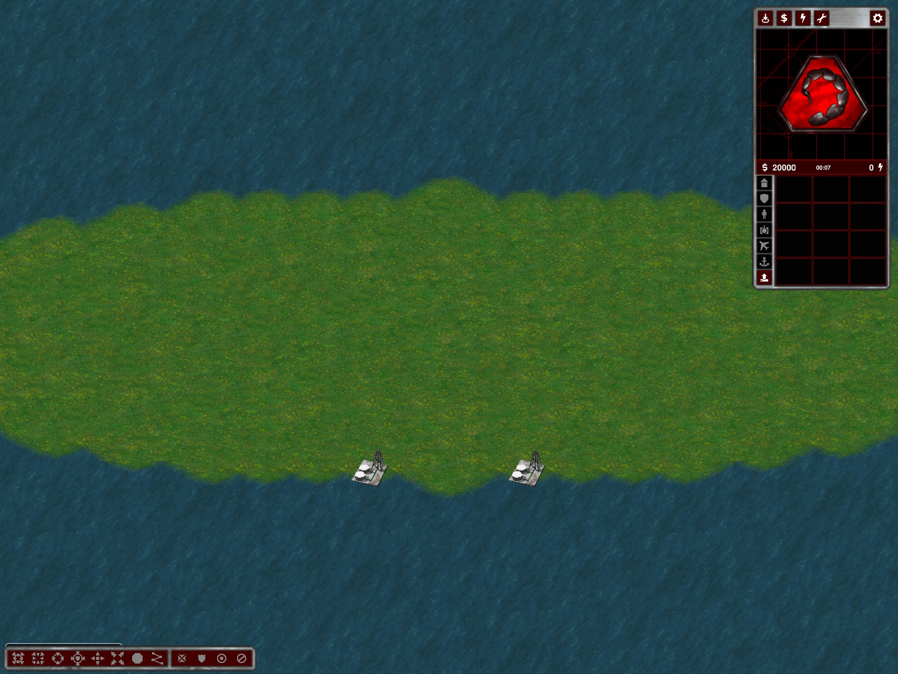

# Migration: two starting oil derricks per player

Migration and Customize / Islands / Mixed Sizes now place exactly two neutral oil derricks on every player's start island when tech buildings are enabled. Home islands still have no Tiberium fields or resource generators; central Tiberium, six central derricks per player and the separate small oil islands remain. Customize's Tech buildings off omits all derricks, including the new home pair.

The home pair is selected on its existing dry-land component. Both native 2x2 footprints must fit on land outside the initial build-clearance disk, remain separate, and avoid the reserved launch shore with a two-cell margin. Placement precedes optional bridge planning so bridge protection sees the buildings. If a pair cannot fit, the complete layout retries rather than dropping a derrick, filling sea or deleting resources. Home terrain sizes and heightmaps are not enlarged.

Validation now requires two oils on each home component (zero when tech is explicitly disabled). The original Migration test's total-oil bounds change from 7–8 to 9–10 per player; its extra-home-oil corruption test still rejects a third derrick.

Evidence `%TEMP%/ymca-migration-home-oil`: 24 plans across 2/3/4/8/12/16 players, seeds 42/43 and bridges off/on; two additional tech-off/infinite-resource checks; canonical preset comparison; actual 4P42 export audited by dry-land component for exactly two oils per home and fully dry footprints. Actual client capture shows the home pair. Modular tests pass 180/180. This is not a fresh naval travel or oil-capture/income-cycle test.

The same build completes the requested wizard simplification: player count, selected/highlighted preset and Generate are on one page. Preview-image clicks no longer advance to a separate configuration screen. Customize retains its own options screen. Actual UI navigation, player-count changes, all preset modes and same-server Change Map with opposite-bank opponent checks pass.

New maps must be generated; existing packages are not rewritten.

