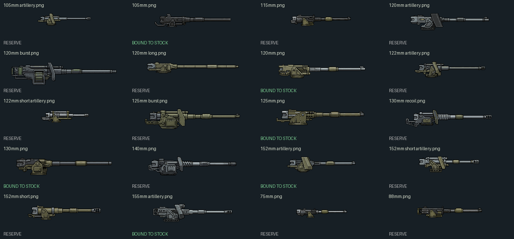

# Cannon portraits: stock-first assignment



The 20 user-supplied PNGs remain unchanged under `mods/ca/bits/modular/cannons/`.
Six ordinary cannon/artillery pictures currently cover **14 chassis families / 15 weapon choices**.
They are shown in the grid, held-item preview and weapon picker. Twin cannon packages draw two
barrels without adding a second component or any firing channels. Rotated held items use a
clockwise-rotated copy; original pixel proportions are preserved and muzzles align to the forward end.

## Assigned pictures

| Picture | Vehicles / existing source |
| --- | --- |
| `105mm.png` | GDI Battle Tank standard. Approved designer label; stock source ID is `120mm`. |
| `120mm.png` | GDI's already-approved +20% alternative; Titan (`TitanGun`, approved 120mm label); Mirage (`120mmHEAT`). |
| `125mm.png` | Heavy Tank and People's Tank, both twin-barrel `125mm` packages. |
| `130mm.png` | Mammoth (`130mmTD`) and Apocalypse (`130mm`), both twin barrels; missiles remain in their original package. |
| `152mm artillery.png` | Akatsiya (`152mm.Akatsiya`) and ISU (`152mm`). |
| `155mm artillery.png` | Nod/Allied Artillery (`155mmTD`/`155mm`), Howitzer (`155mmTDM`), Specter (`155mmSpec`), Nona SVK (`155mm.Nona`). |

This uses **YMCA stock rule bindings**, not an inferred real-world caliber. Nona, for example,
uses `155mm.Nona` here. The original actor preview and in-game sprites/voxels are unchanged.
Only the inventory schematic and contextual component labels change. The supplied image names
do not override damage, range, burst, reload, prerequisites or existing conditional upgrades.

Shared calculator IDs are not sufficient to choose art: `medium-cannon` is shared by GDI,
Challenger and Heavy Tank, while `original-armament` covers many entirely different vehicles.
The registry therefore matches **chassis + selected weapon**. It also gives the picker/properties
contextual names (105mm, 90mm, twin 125mm) without renaming saved component IDs or broad Excel data.

## Missing matching art — do not substitute nearby calibers

- **25mm:** Scout Tank.
- **30mm:** Nod Light Tank, T-34, Devil Tank. T-34 really uses the legacy `30mm` rule in YMCA;
  no silent conversion to a historical caliber is made.
- **90mm:** Challenger; the supplied 88mm is not automatically equivalent.
- **150mm:** Tsar Tank, alongside its existing Tesla channel.
- **183mm:** Tank Destroyer.
- **Unspecified caliber:** Battlemaster, Overlord, Juggernaut, Inferno Cannon and Nuke Cannon.
  Existing named weapon packages do not supply an unambiguous numeric caliber; keep their
  schematic pending a deliberate designation instead of guessing 115/125/140/155mm.
- Mammoth Mk. II uses railguns and missiles. Energy weapons, machine guns and launchers are
  not replaced with ordinary cannon art.

Missing/specialized art keeps the existing procedural schematic. A missing portrait does not
remove or disable the stock vehicle.

## Reserve

The other 14 supplied images are retained for later, not added as new selectable weapon parts:
`75mm`, `88mm`, `115mm`, `140mm`, `105mm artillery`, `120mm artillery`, `122mm artillery`,
`122mm short artillery`, `152mm short artillery`, `152mm short`, `120mm burst`, `125mm burst`,
`120mm long` and `130mm recoil`.

A `burst`/`recoil`/`long` filename is not permission to change gameplay. Matching upgrades need
separate reviewed bindings. New engine, generator and infantry PNGs are outside this cannon pass.

## Regeneration and validation

Edit `tools/modular/cannon-art-bindings.json`, then run:

```
python tools/modular/generate_cannon_art.py
```

This regenerates the C# presentation registry, `cannon-icons.png`, the marked chrome collection
and the review sheet. The irregular-sized original PNGs are packed unscaled with rotated copies
in a **1024×1024 power-of-two atlas**, avoiding direct upload of non-power-of-two sources.
Commit changed sources and generated outputs together; restart OpenRA to refresh the art.

Native tests cover chassis-qualified labels, missing-art fallbacks and unchanged profiles/rules/
weapon options. Python tests compare original pixels, rotations, chrome regions and reserved variants.
The existing preview utility additionally validates all **22 assigned/missing-art registry entries**
against resolved stock actors and armaments, including dual muzzle offsets. Automated checks do not
replace live review of artwork size and placement. The main grid's footprints and shared-edge rules
are unchanged.
