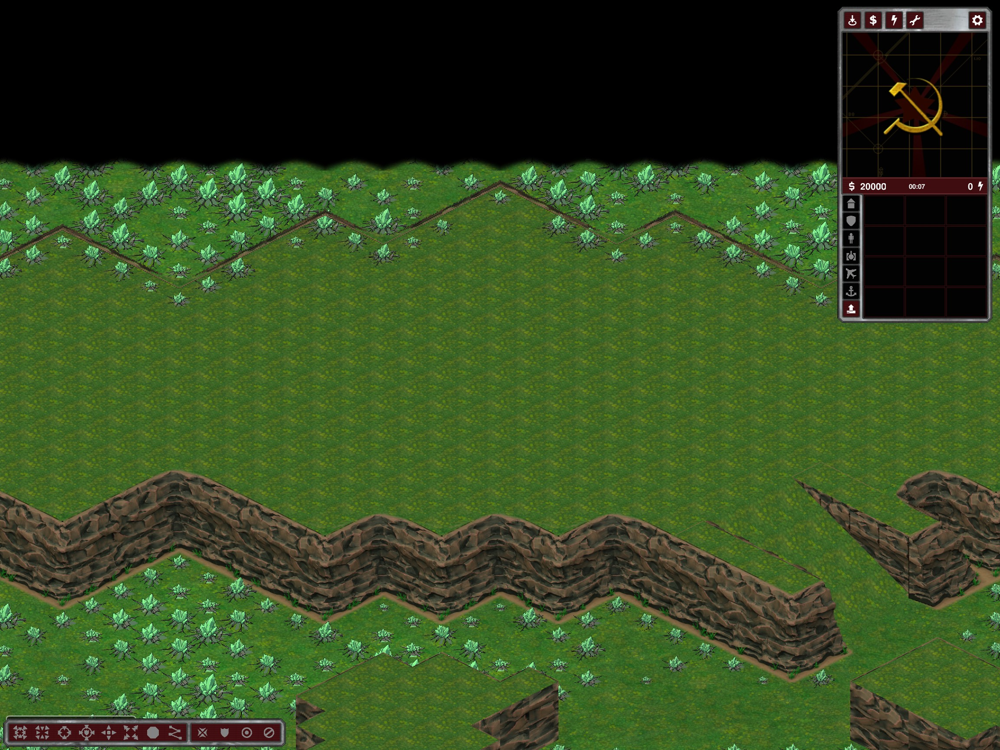

# Mountain Valleys: empty starting roofs; legacy wall issue remains

The generator still explicitly added two 25-cell resource patches to each starting plateau. Its general Glitter predicate also allowed additional roof cells beyond the radius-nine build-clearance disk. Both placement paths are now corrected: the forced patches are removed and the general resource predicate excludes all plateau surfaces, ramps and Home cells. Validation rejects resources (green or rich), generators or tech buildings on any plateau surface. Economy stays in the valleys; no replacement starting deposits are guaranteed.

This applies to Mountain Valleys and its equivalent Custom Map Parameters combination (Hills, disconnected starts, no central battle). Other preset economies are unchanged. It changes generation, not existing saved maps or general gameplay growth rules.

## Evidence

`%TEMP%/ymca-mountain-feedback`:

- 27 custom plan checks: Tactical/Operational/Strategic, 2/4/8 players, None/Glitter/Patches, seed 42. The test command independently rejects economy on plateau surfaces.
- Reconstructed the latest observed Mountain Valleys seed 1493471248 / Tactical / 4 players using the previously installed binary, then exported the corrected canonical preset/custom path.
- Exported elevated resource cells: **604 before, zero after**. Total field cells: 5,596 before, 4,986 after. Terrain-tile and height arrays compare byte-for-byte equal. Random valley resource placement can differ because the eligibility filter changes random-number consumption.
- Actual client views captured before/after. Modular tests pass 180/180.
- The original session package was already removed by normal-exit temporary-map cleanup before copying; the baseline is a seed reconstruction, not a preserved copy of the user's package.

## Original diagnosis: intermediate rock edges

**Update:** the subsequent [closed expansion-wall implementation](map-rocks-and-dry-oil.md) replaces this legacy path. The paragraph below records the earlier resource-only fix.

The middle/expansion view reproduces old jagged wall joins and thin rear outlines. These expansion rims still pass through `RubberduckMountainRenderer.Apply` / the older `RubberduckPlateauRenderer.Apply` wall composition (`cliff17` and `mountainwall*`), while home plateaus use reserved closed contours. This change does **not** repair those visuals. A topology/renderer correction must preserve expansion access, protected routes and collision; no walls were simply deleted or hidden in this resource fix.

