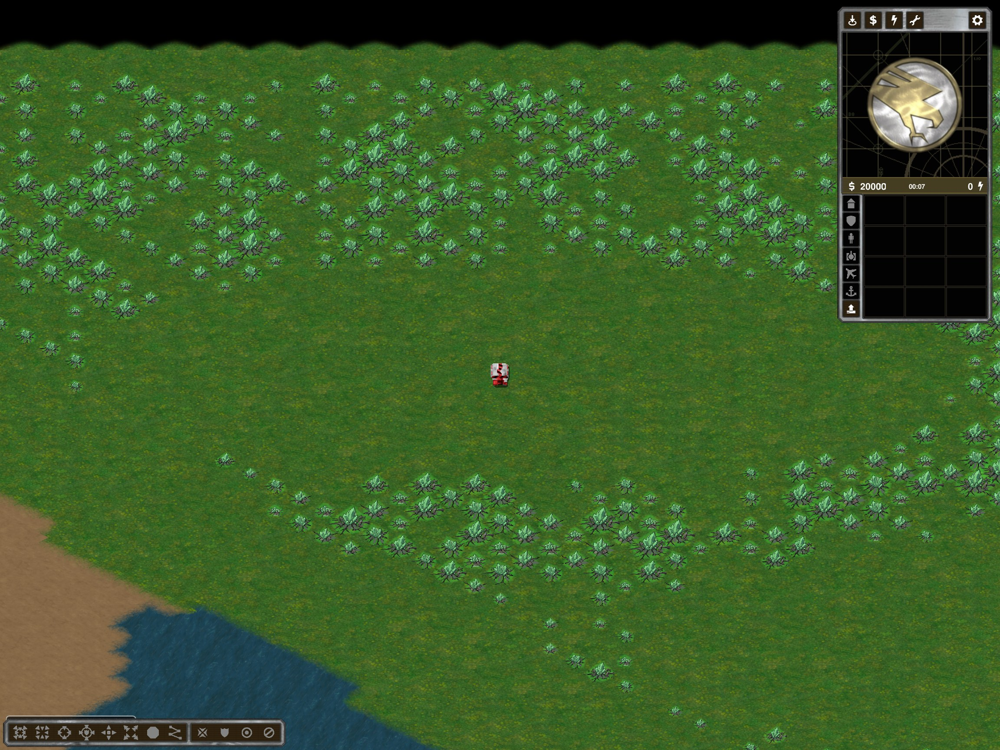

# Connected River: Glitter and opponent regression

## Resource failure

TwoSidesGenerator's Glitter branch required `HomeOwnerAt >= 0` while excluding `BuildClearance`. Its home-owner disks and cleared start disks were both radius nine: the conditions excluded every resource cell. Trees were still placed separately, explaining a tree without an initial field. The preset's default Patches branch did not expose this bug.

Glitter now populates eligible dry bank land, excluding start build disks and a clearance band around water, cliff/launch shores and the central crossing. The existing river/causeway geometry and Patches generation are unchanged. Generator validation requires nearby resources for every start for both Patches and Glitter, rather than checking Patches alone.

## Opponent moved to the same bank

The engine's existing Change Map operation compacts occupied lobby slots. A human in Multi0 and enemy bot in Multi2 can become Multi0/Multi1. On a four-player Two Sides map, both slots are locked to team 1 and the same river bank.

SkirmishLogicCA now remembers which bots were opponents before a map change. In a single-human local skirmish, if a locked-team destination map turns an existing opponent into an ally, it relocates that bot to an available opposing slot and reapplies map-locked team/spawn settings. Bot identity, difficulty and color are retained. Deliberate allies and same-map team edits are not remapped; ordinary multiplayer is untouched. No engine modification or saved-map rewrite is involved.

## Evidence

`%TEMP%/ymca-river-glitter-fix`:

- Twelve plan cases: Tactical/Operational, 2/4/8 players, seeds 42/43. Initial batch timed out after eleven; the final case was run separately. Glitter has 2,555–7,436 cells.
- Actual 4P42 export: 3,858 green resource cells and both continuous protected coast segments. Live resource layer: 3,857 unoccupied green cells present, extraction passed. This is an API extraction check, not a complete harvester delivery test.
- Connected River without Battle Center also exported successfully: 4,891 cells and three bridges.
- Default Patches canonical comparison passed.
- Real same-server lobby sequence Strategic Two Sides -> Plains -> Tactical Two Sides: human team 1/spawn 1, existing enemy bot team 2/spawn 3. Test previously covered map replacement but did not assert that the bot remained an opponent after replacement.
- Modular tests: 180/180. Release compilation: zero errors, three existing warnings.

Restart and regenerate to obtain the missing initial fields. Old packages retain their original resource contents.

