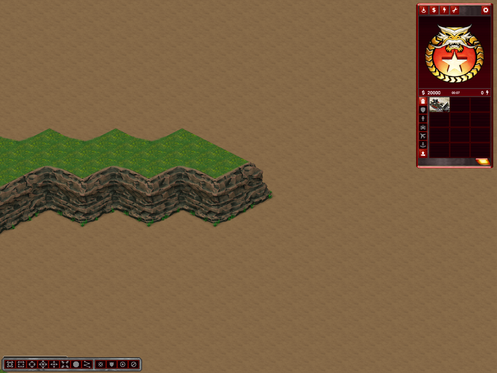
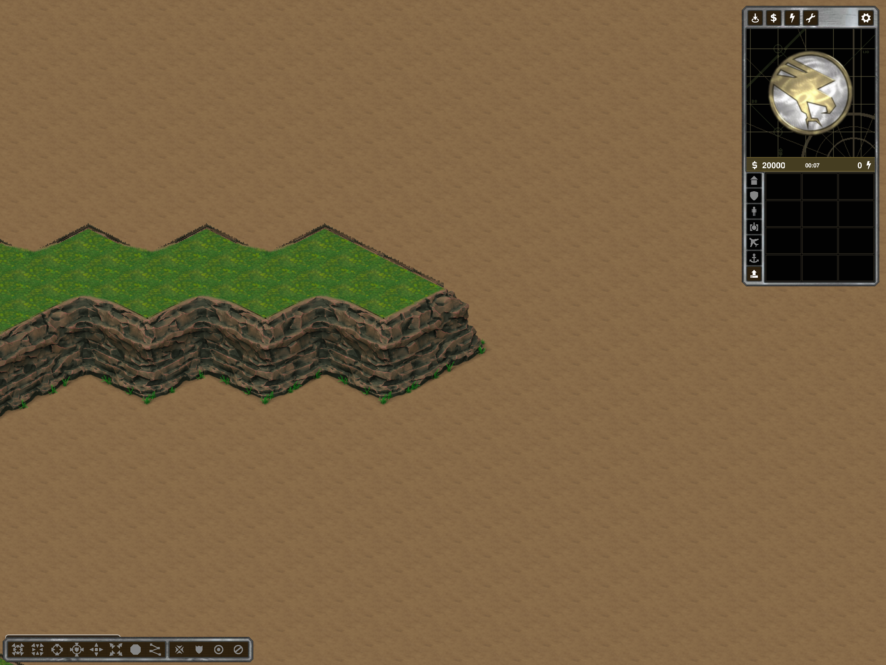

# Shared NW/NE rock crest on grass and dirt

Follow-up: [black upper-line correction](cliff-black-upper-lines.md) retains this crest but clips the opaque matte row below the roof socket; the runtime limit is now three pixels rather than four.

User approved the new Hill Fortress/Battle Nexus contours and requested a slightly wider, recognizable rear edge, including where it meets central dirt. This follow-up changes **shared closed-cliff artwork**, not either preset's map layout.

`RubberduckRearRimArt` adds a narrow, irregular stone crest (9–12 source pixels, fewer screen pixels when zoomed out) above the rear roof edge. RGB samples come from authored rock-face interiors in the immutable `grassland_1x1.png` atlas, not dirt terrain. Existing visible lip pixels are retained. Both rear orientations, their three variants and rear inner/outer corners use the same recipe. `--rubberduck-closed-cliff-art` remains the reproducible export entry point; output provenance records source and derivative hashes.

An initial wider strip *inside* the rear plane was hidden by the roof and rejected. The accepted addition is above that edge, where it remains distinguishable on dirt. Normal nearer-roof occlusion still applies at joins. An experimental renderer ownership adjustment made no useful improvement and was reverted: the existing depth clipping and four-pixel hidden-interior limit remain unchanged. No black matte is exposed and no dirt overlay is added.

Scope:
- Eight shared rear/corner sprites changed. Fourteen front, side, front-corner and ramp-mouth sprites remain byte-identical.
- Sprite dimensions/metadata, actors, heights, collision, routes, resources and generator decisions are unchanged.
- Normal play and editor previews consume the same shared sprites. Standard saved maps using these closed-cliff actors pick up the change after reload; no regeneration is required.
- Old map-local/custom artwork and legacy projected wall assets are not silently rewritten. Two Sides rock-coast art is untouched.

Checks:
- `--rubberduck-rear-rim-test SOURCE BEFORE AFTER`: all 22 sprites checked; deterministic source sampling, bounded rear-only pixel changes, non-black rock samples, identical sprite geometry/metadata and unchanged front/ramp vocabulary.
- Actual Battle Nexus-derived normal client captures on grass and light dirt, before/after using identical `map.bin` data within each pair. The diagnostic ground substitutions exist only in temporary fixtures.
- Actual shaded editor capture on dirt; diagnostic Undo/Redo/save/reload checks passed. This was a render/history check, not a new gameplay balance or movement certification.
- Standard Release build installed successfully; no runtime renderer, gameplay or generator changes were retained for this follow-up.

Evidence: `%TEMP%/ymca-rear-rim-feedback` (art recipes, originals backup, audit, captures, editor result pointer and build logs). Source assets remain unchanged. Diagnostic fixtures are moved out of the map list. No commit/push.
