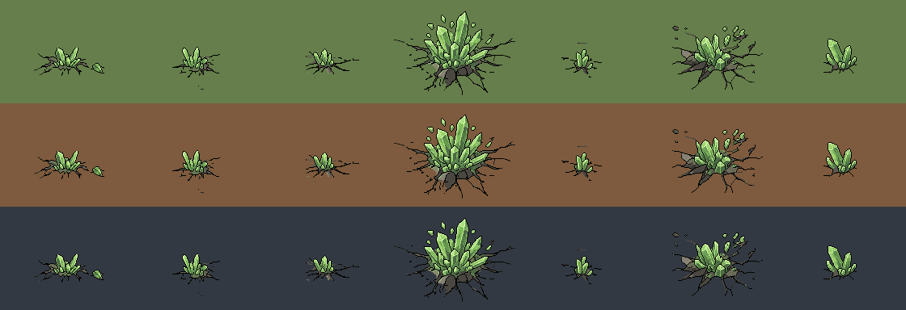
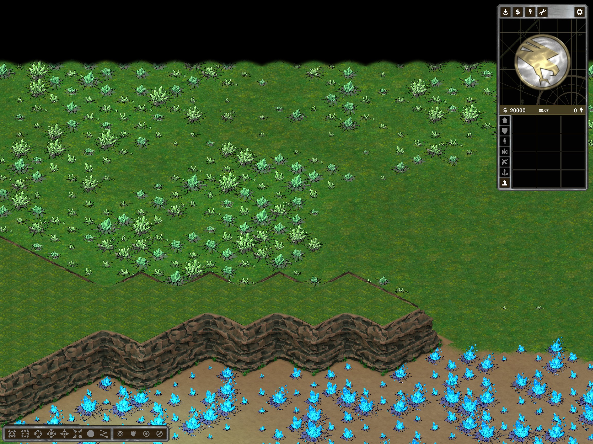

# Seven additional authored green crystals

Current runtime selection: [size filtering and green palette harmonization](crystal-size-and-color.md). The extraction below still retains every original motif, but new motifs 4 and 6 are no longer used in-game.

Source: repository-root `7 green crystals.png`, 256x256 indexed PNG, unchanged.
SHA256: `b87fc7d54394a3c4be0b2437749d180a6054e1d0c44dce905c48de5a0cd994c3`.

`tools/extract-seven-green-crystals.ts` extracts the seven connected bodies and assigns each detached shard/crack component to its nearest main-body pixel. All **11,596 nontransparent source RGBA pixels** are retained exactly once. Unlike the previous sheet, no ground-color replacement is applied. No glow, color changes or new shadows are baked into the sprites.

Outputs: `mods/ca/bits/resources/green-crystals-seven/`:

- Seven `green-crystal-N-body.png` files in source-size detail.
- Seven `green-crystal-N-growth.png` atlases: twelve nearest-neighbor density sizes, 45–100%; full density is the unchanged original size, not the earlier rejected 70% trial.
- Frames 160x128; anchor (80,80); metadata `FrameAmount: 12`, `Offset: 0,-16`.
- `preview.png` over grass/dirt/dark backgrounds and `provenance.txt` with source anchors and per-motif pixel counts.

The source anchors, in sequence order, are (39,84), (224,85), (62,145), (155,145), (232,164), (72,214), (235,242). All seven motifs are included, including the two larger ones; no size-based selection has been made yet.

## Integration

On normal and shaded Rubberduck, `ti1`–`ti4` retain the four previous motifs. `ti5`–`ti11` use these seven new motifs. `ti12` repeats the small upper-left new motif, so there are **eleven distinct green motifs** across the twelve sequence slots. The twelve slots are variants, while each atlas independently contains twelve density frames.

Blue crystals, other tilesets, resource quantity/value/growth/harvesting, and existing density-dependent terrain lighting are unchanged. Game and editor share the sequences. Restart/reload is sufficient for existing maps; no regeneration or executable rebuild is required.

## Reproduction and checks

From `Game`, with external `tsx`, `pngjs` and Node types available through `NODE_PATH`:

```text
node <dependencies>/tsx/dist/cli.mjs tools/extract-seven-green-crystals.ts "../7 green crystals.png" mods/ca/bits/resources/green-crystals-seven
```

The extractor rejects an unexpected source hash, overlapping pixel assignments and frame clipping. Independent Pillow checks reconstruct the complete source image from all seven body sprites, compare each last density frame byte-for-byte with its body, verify frame metadata, and verify that all three crystal source artwork hashes remain unchanged. TypeScript ES2022/Node16 checking passed.

Actual normal/shaded clients loaded the mixed old/new green fields and unchanged blue fields. Evidence: `%TEMP%/ymca-seven-crystals`. This is asset/runtime validation, not a new harvesting, network, lighting lifecycle or editor Undo/Redo certification.



