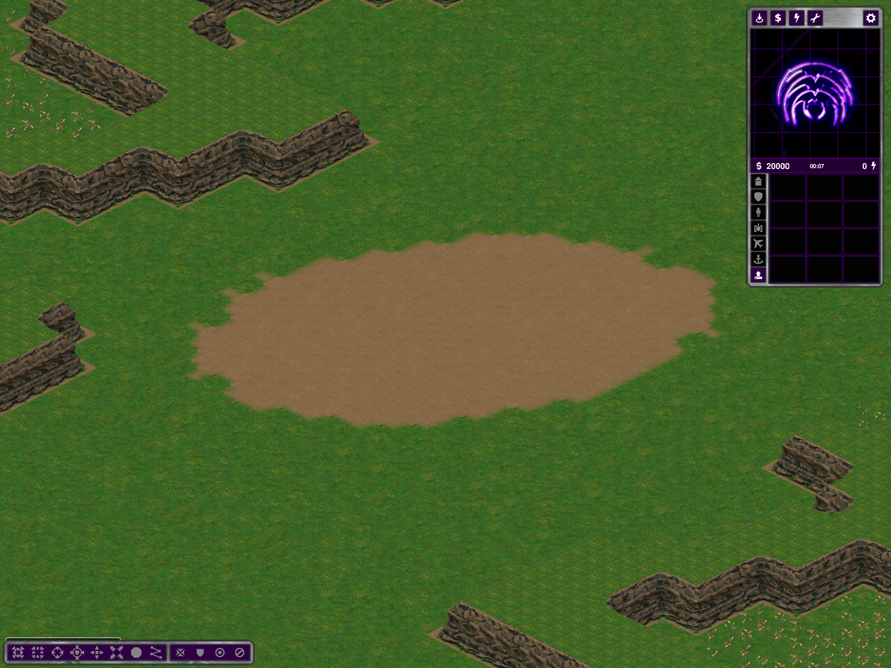
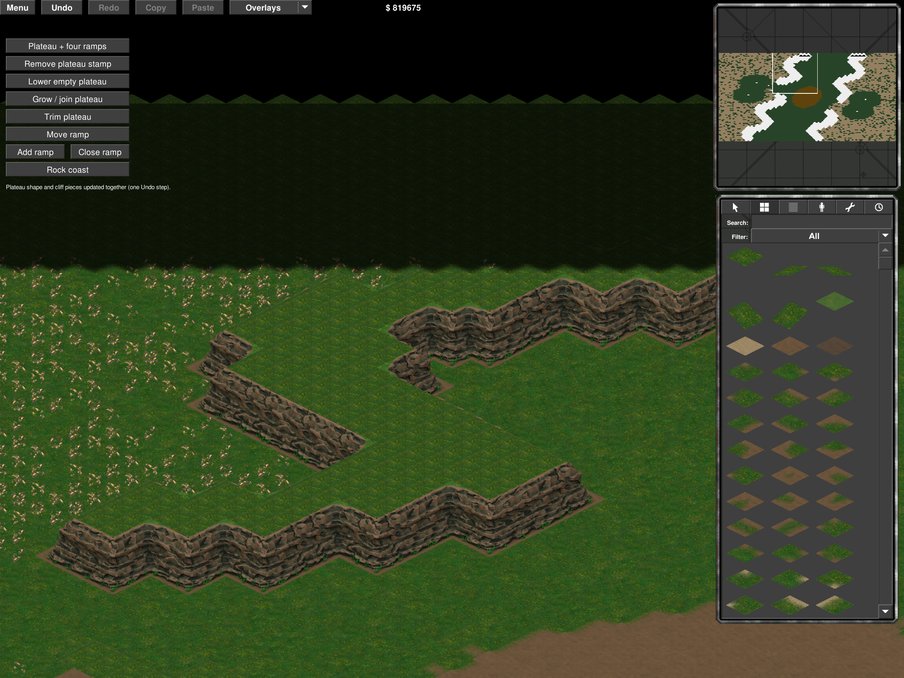
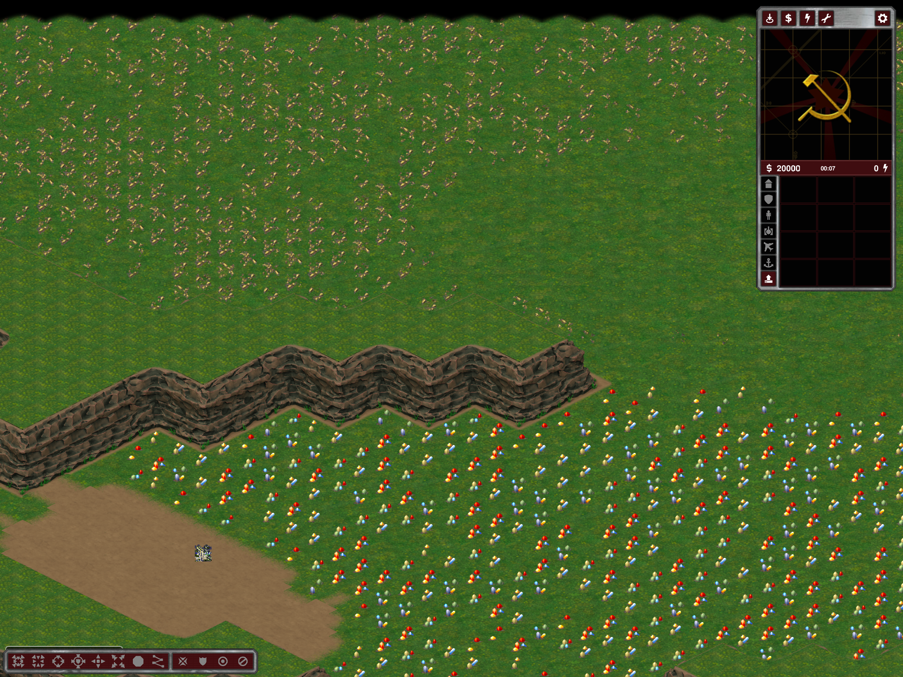

# Shared mountain contours — generator/editor follow-up

**Hill Fortress follow-up:** its blocked ridges have since been replaced by [walkable team plateaus and a low valley](hill-fortress-team-plateaus.md). The blocked-roof description below remains historical for Hill Fortress and current for Battle Nexus.

This supersedes the outline limitation in [the first material pass](shared-mountain-visuals.md). It replaces legacy per-cell walls in newly generated Hill Fortress and Battle Nexus maps with the existing shared closed-cliff vocabulary (authored straight faces, inner/outer corners and reserved feet). It does not promise arbitrary smooth curves: the terrain remains tile-based.

## Scope and preservation

`RubberduckMountainTopology.Prepare` fits raw mountain components onto two-cell native contour runs. Four deterministic grid phases are tried; diagonal-only contacts are joined only on permitted terrain. Complete proposals must retain a connected roof, boundary-reaching ends and valid closed sockets. Unsupported complete layouts are retried, not exported with fallback walls.

- Hill Fortress and Battle Nexus call this before economy placement. Optional raw mountain lines in Open Plains use the same fitter, respecting already reserved economy. Arabia's already planned closed contours are a no-op; Mountain Valleys keeps its native plateau/ramp planner and shares the same renderer.
- Water, starts, build clearance, entrances, bottlenecks, resources, tech, bridges, existing plateaus and Strategic reservations cannot be overwritten by the fitter.
- Roofs remain blocked at height four; feet are visibly represented blocked ground at height zero. Removed outline cells become ordinary ground, not invisible blockers. Checkpoint clearing may not flatten reserved cliff feet.
- **Newly generated maps change local outlines and can change resource placement/retry outcomes.** This is not a byte-preserving cosmetic modification of old maps. The preset's stronghold/center/gate structure remains subject to its existing validators.
- Saved maps are not rewritten. Their shared material variation updates on load, but obtaining the new contours requires regeneration.
- Water Basins 4P/569840303 and Two Sides 4P/1226359626 were regenerated and compared with the previously accepted exports: both `map.bin` and the complete `map.yaml` are byte-identical.

## Editor parity

Generated closed contours are recovered by the existing shape brush and composed by the same renderer. Extending a wholly blocked mountain preserves blocked roofs instead of producing an inaccessible walkable island. Ordinary walkable plateaus retain their previous behavior.

Interior edits to boundary-reaching ridges now freeze existing edge geometry instead of rejecting the entire connected component. The brush still cannot paint near the boundary. Topology recovery includes blocked roof cells whose raised projection is partly clipped at the top edge: they still own visible in-bounds cliff sockets. The export audit originally exposed this missing recovery case; it was corrected rather than dropping the actors or weakening socket validation.

## Checks performed

- Installed standard Release build: zero errors, three existing warnings. Modular NUnit suite: 180 passed, none failed; `git diff --check` passed.
- `--shared-mountain-topology-test OUTPUT`: **32 twice-generated physical exports**, Hill Fortress Tactical/Operational/Strategic and Battle Nexus Tactical, 2/4/8/16 players, seeds 42 and 120999725. Terrain/features/starts/surfaces deterministic; no economy overlap, unplanned mountains or legacy wall fallback. Protected-input negative control confirms atomic rejection.
- `--rubberduck-closed-contour-test OUTPUT`: all 32 exported actor graphs match unique reconstructed sockets; 180 general contours, 543 corrupt rejections, five source fixtures and 52 protected feet pass.
- Arabia regression: 12 twice-generated physical exports, 2/3/4/8/12/16 players. Mountain Valleys Strategic 4P/42 export passes.
- Actual Hill Fortress editor normal/shaded: real shape brush, non-mutating preview, blocked extension, exact Undo/Redo of terrain/resources/actors, exact save/reload. Ordinary walkable plateau shape regression also passed in the real editor: join/trim, protection/cancellation, full Undo/Redo chain and save/reload. Its early preview screenshot was not treated as completion; a longer capture run verified the final result.
- Actual Hill Fortress Strategic 4P/120999725 movement: all 12 home-to-command visits completed by tick 2254. Teams run sequentially; these ticks are not a cross-team balance measurement.
- Actual Hill Fortress and Battle Nexus client views, plus normal/shaded editor views inspected. Full WAN, victory, all-seed reliability and a new long soak are not claimed. Some 16-player Nexus cases needed 10–16 retries within the existing 32-attempt limit.

The first bounded matrix/audit invocations hit the tool timeout and were rerun to completion with longer limits; this was not a successful test claim based on partial output. The initial editor preflight correctly rejected the old boundary restriction and then the accidental walkable extension; the shared fixes above passed subsequent real-editor checks.

Evidence: `%TEMP%/ymca-shared-mountains` (`matrix.log`, `contour-audit.log`, editor/play result pointers, screenshots, build logs). Diagnostic fixtures are moved out of the playable map list. No commit or push.
