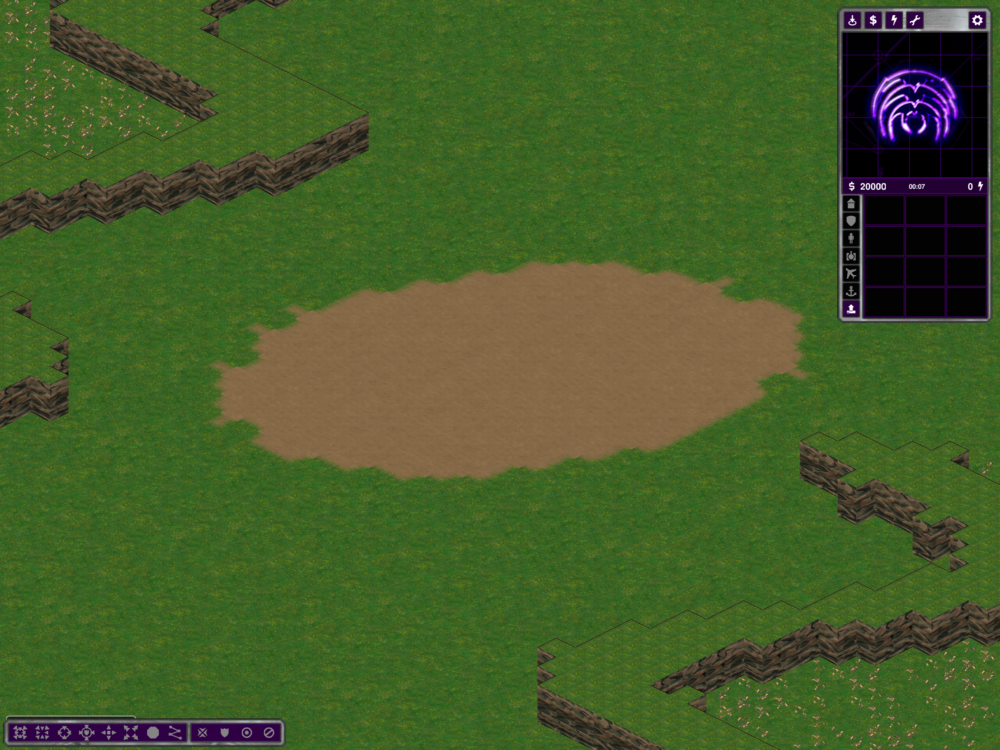
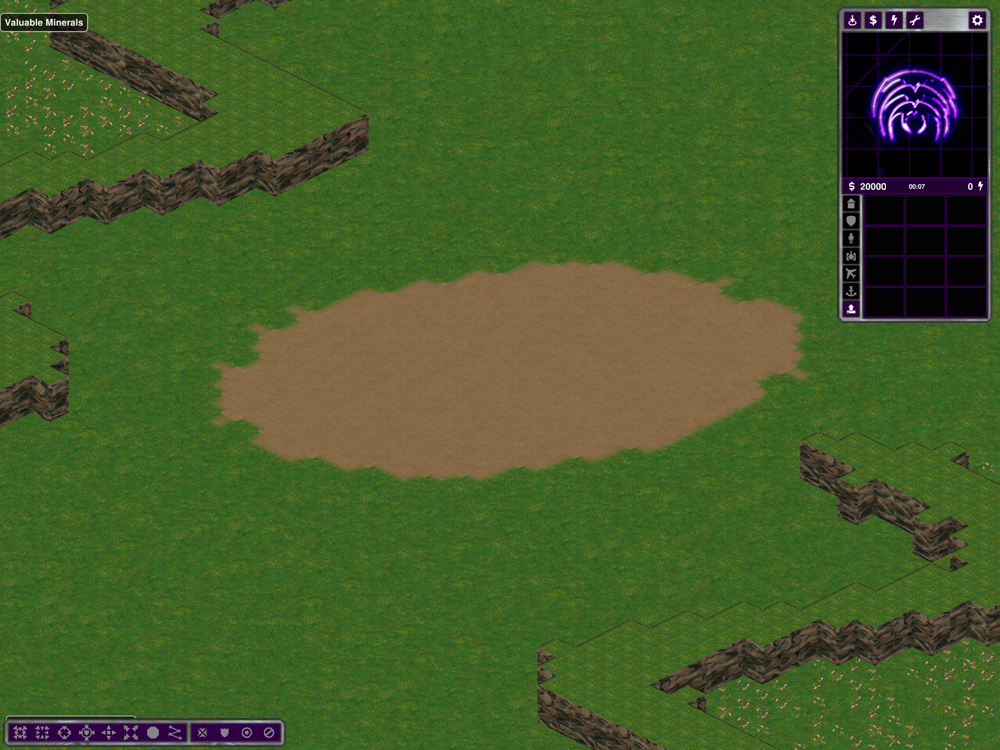
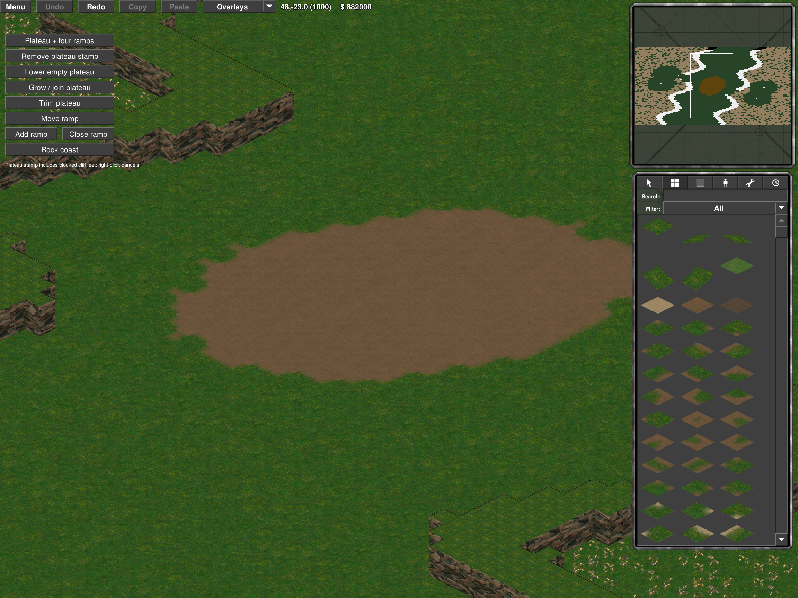

# Shared mountain material and corner rendering (first pass)

**Follow-up:** [shared mountain contours](shared-mountain-contours.md) now replaces
legacy single-cell walls in new generation. The limitations below describe this
first material-only pass, not the subsequent contour/editor implementation.

User reference: Operational Hill Fortress 4P/120999725. This is a renderer/material change, **not a completed solution for the stepped geometric ridge outline**. The original per-cell height/collision contour remains visible, especially at staircase-shaped boundaries. No claim that every mountain now looks smooth is made.

## Shared implementation

There is no Hill Fortress/preset branch in the visual code:

- `RubberduckCliffVisuals` provides deterministic coordinate-based variation for `PlateauFaceBody` and `NativeCliffBody`, used by live actors and their existing editor previews. No world RNG or actor order is consulted.
- Legacy projected mountain faces now have nine distinct source-window samples per direction instead of three (36 frames). Existing native/closed straight faces retain their three authored variants but use the same stable selection method; explicit corner and ramp-mouth slots remain unchanged.
- `PlateauFaceBody` reads neighboring heights to distinguish straight, convex and concave joins. Sixteen source-derived corner overlays fade over twelve pixels inside the original wall mask and use the existing foreground-terrain clipping. These improve material joins; they do **not** replace the collision contour with rounded geometry.
- Terrain revision invalidation updates these choices after edits. No actor graph, tile, resource, height, ramp, spawn or objective is modified by these renderers. Saved maps using the standard mountain actors receive the material change without regeneration.
- Two Sides rock-coast rendering and Water Basins planning are untouched.

Source `grassland/grassland_1x1.png` remains immutable. `--rubberduck-mountain-art` reproducibly produces the two derivative atlases and provenance. All 36 face alpha masks exactly match the old full-height wall mask. The new corner alpha is bounded by that mask. Source-window samples/fades are derivatives, not a claim to untouched native silhouettes.

## Evidence and limits

- Release build and `--rubberduck-cliff-visual-test ART_DIRECTORY` pass: nine distinct frames in each direction, exact old wall masks, sixteen bounded overlays, variation on axes/diagonals including negative coordinates, unchanged explicit corner/ramp slots.
- Actual before/after on the **same saved** Hill Fortress map; normal and shaded client renders captured. Repetition is reduced, while the stepped outline remains.
- Actual normal/shaded editor probes: convex/concave neighborhood changes, exact terrain/resources/actor and slice restoration through Undo/Redo, exact terrain/heights/resources/actor save/reload. The first editor fixture omitted its `EditorWorld` probe override and timed out; corrected fixtures passed.
- Actual Battle Nexus (Tactical) and Arabia closed-cliff close-ups inspected, covering both rendering families. The first Battle Nexus request used an unsupported Strategic mode; the corrected Tactical fixture passed. No generator/gameplay defect was inferred from that rejected request.
- No new balance, multiplayer, movement or long-soak acceptance. Geometric ridge smoothing still needs a separate solution consistent with height/collision and shared editor behavior; this first pass must not be described as that completed fix.

Evidence: `%TEMP%/ymca-shared-mountains` (source art audit, visual test, build logs, client captures, editor result pointers). Only diagnostic map fixtures created for this pass are moved out of the repository map list. Changes remain local/uncommitted/unpushed.
