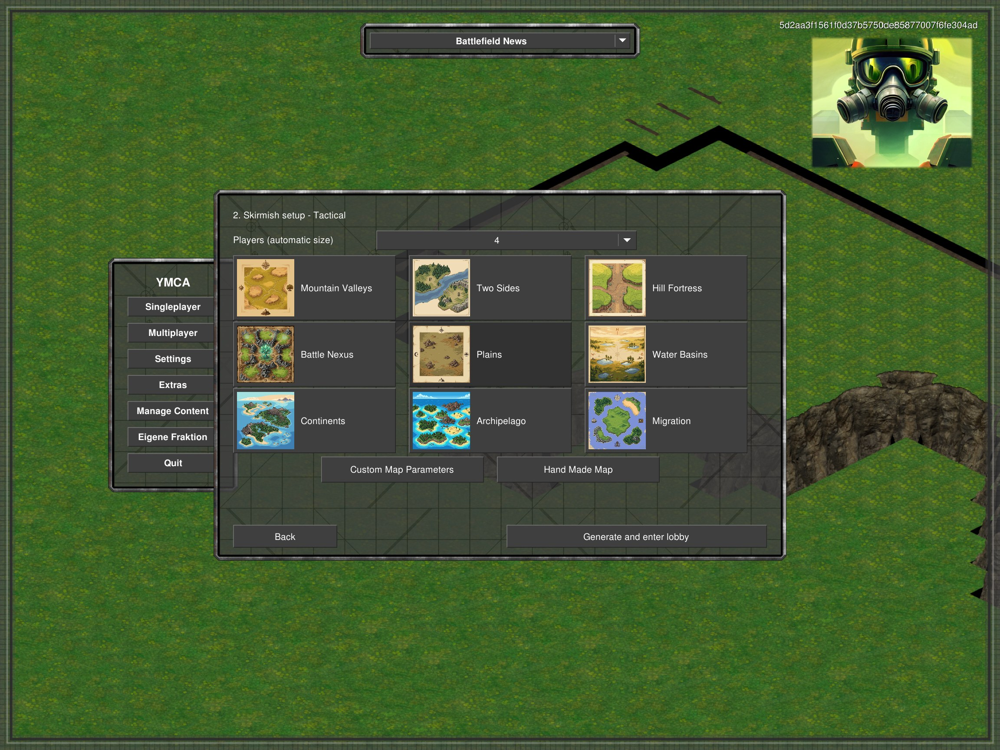

# Skirmish preset previews

The preset-selection page uses all nine original 256×256 images from `mods/ca/bits/misc/map preview/`, without rewriting them. `chrome-map-previews.yaml` explicitly maps the internal Arabia preset to `Plains.png`.

Cards show an 88×88 preview next to the preset name. The entire card, including its image, retains standard button input and hover behavior. The three-column grid fits the existing dialog, with Customize and Hand Made Map below it. Mode filtering is unchanged: Tactical/Operational show nine presets, Strategic five. The same page is used by Skirmish Change Map.

Validation: actual client screenshots for all three modes; preview-area mouse down/up selects Plains and Two Sides; card counts/bounds, chooser/cancel, Customize/Back and same-lobby Change Map pass. Evidence: `%TEMP%/ymca-ui-probes/preset-previews` and `%TEMP%/ymca-preset-previews`. Release build succeeds with the three existing warnings; Modular tests pass 180/180. No generator or gameplay changes.
