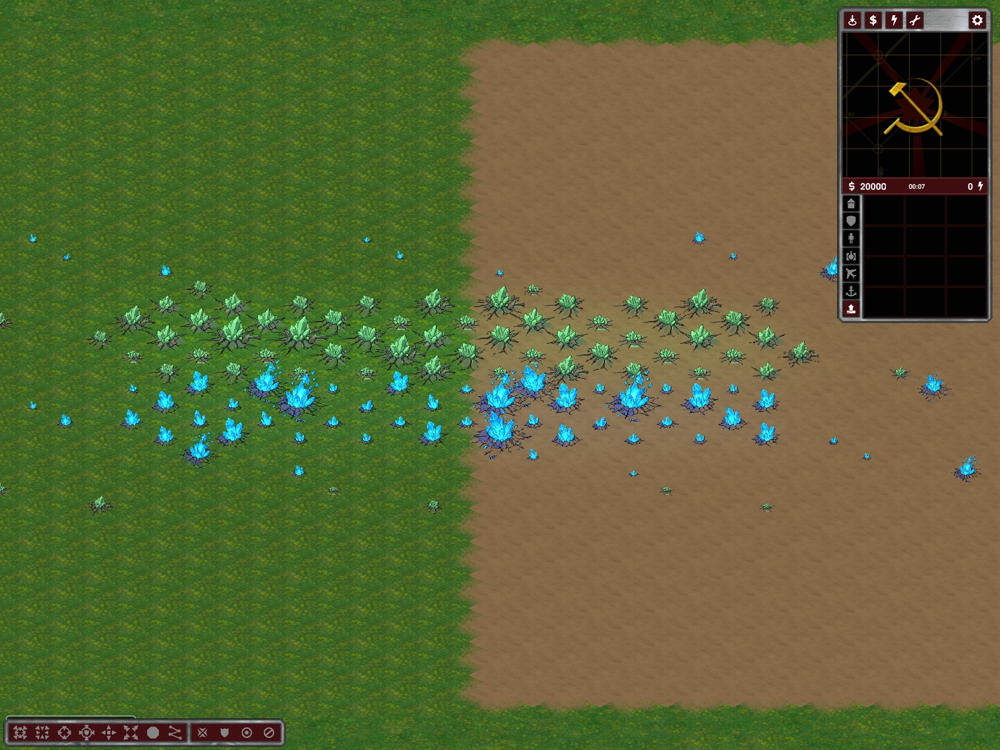

# Dynamic resource terrain light

Rubberduck normal/shaded resource sprites now have **no baked-in glow**. Original authored body/crack pixels, sizes, density stages and source PNGs remain unchanged. Extractors still emit separate `*-glow.png` diagnostic references, but runtime combined/growth atlases no longer contain them.

`TiberiumTerrainLight` on the shared base world uses the same `TerrainLighting.AddLightSource` / `RemoveLightSource` system as the trees. Tree actors themselves remain unchanged. One render-local light is maintained per known nonempty Tiberium cell, radius 1.5 cells, intensity 0.025 at full density. Green tint is (0,0.075,0.025), blue (0,0.04,0.09), scaled continuously by density/max density. Nearby contributions naturally overlap, but the short radius bounds stacking. No actor is created for a crystal.

Initial resource cells enter a pending set. Resource-layer cell-change events mark later changes; render ticks process only dirty cells whose resource state is visible. Harvesting reduces intensity, depletion removes the light, type replacement changes its color and regrowth recreates it. Multiple changes between render frames coalesce. Hidden changes retain last-seen light; a previously unknown field does not light up until visible. In particular, initially unexplored resources cannot leak their position through light spilling across a fog boundary. This is deliberately stricter than rendering initial resource sprites through the Explored Map option.

The state is local rendering only, not synchronized simulation state. The shared world registration also connects to the editor resource layer, whose normal cell-change notifications feed the same path. On world disposal, event handlers and owned light tokens are removed. Non-Rubberduck tilesets are left alone. No engine changes were required.

## Scoped validation

Evidence `%TEMP%/ymca-tiberium-light`:

- Actual normal and shaded clients passed `TiberiumLightProbe`: green/blue terrain-tint values, partial extraction/dimming, full depletion, type replacement and regrowth.
- The same probes turned fog on, changed resources in unseen cells, verified that remembered light did not change and unknown growth did not create light, then revealed them and verified refresh/removal.
- A mixed dense field on grass/Dirt was viewed in the actual client without embedded PNG glow.
- Generated base sprites equal their body images; final density frames equal the body, and original source hashes remain unchanged.
- These resource-API probes are not a harvester travel/delivery test, a new editor Undo/Redo/save/reload certification, or a large-map rendering performance/multiplayer soak test.

Restart the client; existing map packages need no regeneration.

