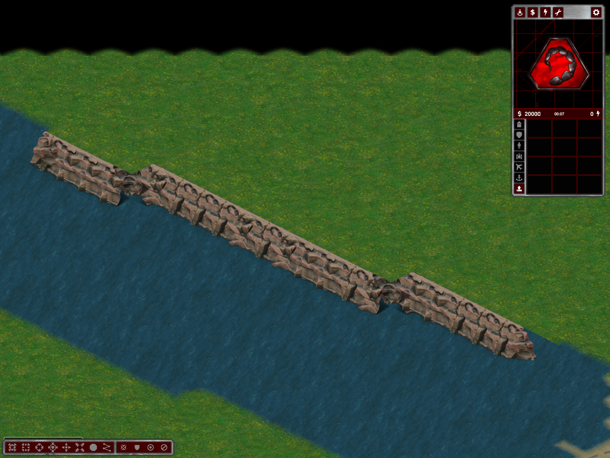
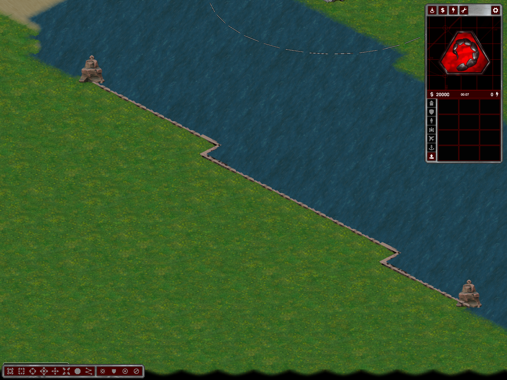

# Continuous Two Sides rock coasts

Follow-up to [the wider crossing](two-sides-wide-crossing.md), using user seed `1226359626`.
The later [map-edge and low-end update](two-sides-edge-coasts.md) supersedes the two-pile endpoint behavior and saved-layout equivalence below.

## Changes

- Candidate bank cells no longer need a hypothetical end-cap footprint at every interior step. Validate the complete contour and its actual ends; trim only actual endpoints (up to eight cells), retain at least six bank cells, and reject an invalid complete proposal.
- Preserve every native face at continuous-bank concave joints. Corner art supplements rather than removes those faces.
- Shared runtime/editor `RockCoastBody` uses the real bank plane. Rear faces and corner 29 project +64px; front corners 24/25 project -64px. Rear components retain a narrow crest through short forward-facing steps; side corners clip their raised source-roof interior to the bank band. Original end piles remain at the two actual endpoints.
- No source PNG changes, added boulder decorations, water fill, grass replacement, or height changes. Longer cliffs necessarily extend blocked cliff occupancy; locomotors are unchanged. Underlying normalized terrain, heights, resources, and every non-coast actor match the user's saved map exactly.
- Editor removal recognizes the complete new actor graph; extension preserves its bank-projection style. Undo restores the original graph rather than regenerating it.

## Checks

- Release build and `--two-sides-test`: 36 twice-generated cases passed.
- New `--two-sides-coast-test OUTPUT`: eight exports, seeds 42, 43, 1226359626, 1652607081, 1494919500, 65690028, 165374254, 1775378146. Every blocked-bank water-facing edge has its native face actor; each of the sixteen runs has exactly two ends.
- Actual normal-tileset client, seed 1226359626: front/rear close-ups inspected; all twelve autonomous objective visits completed by tick 1504.
- Actual naval client: four docks, eight productions, sixteen reciprocal route legs passed.
- Actual editor: both complete components removed and restored with exact Undo/Redo, terrain/resources/actors saved and reloaded identically. New opt-in `ContinuousCoastEditorProbe`; no production-map probe injection.
- Old analytic `RearRoof` checks were removed: they did not exercise the new bank-plane renderer. Framebuffer and contour checks above supersede them.

Evidence: `%TEMP%/ymca-continuous-rock/{crest,accepted,editor,naval,matrix}` and associated result pointers/logs. Earlier `bank-plane`, `corners`, and boulder captures are rejected intermediate experiments, not acceptance.

This does not establish all-corner/all-preset visual acceptance, shaded rendering, a new long soak, multiplayer fairness, or complete Strategic victory acceptance. Restart and regenerate Two Sides to receive longer contours and the new corner actors. Changes remain local/uncommitted.
