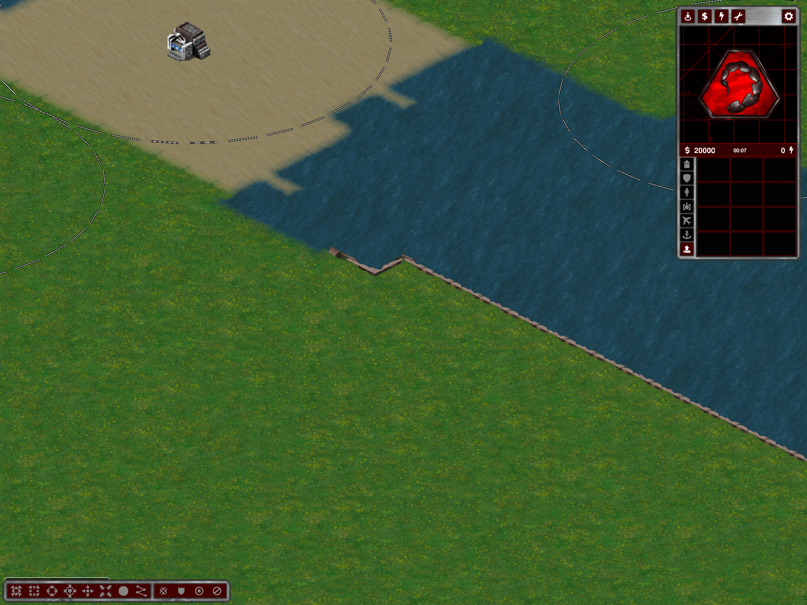
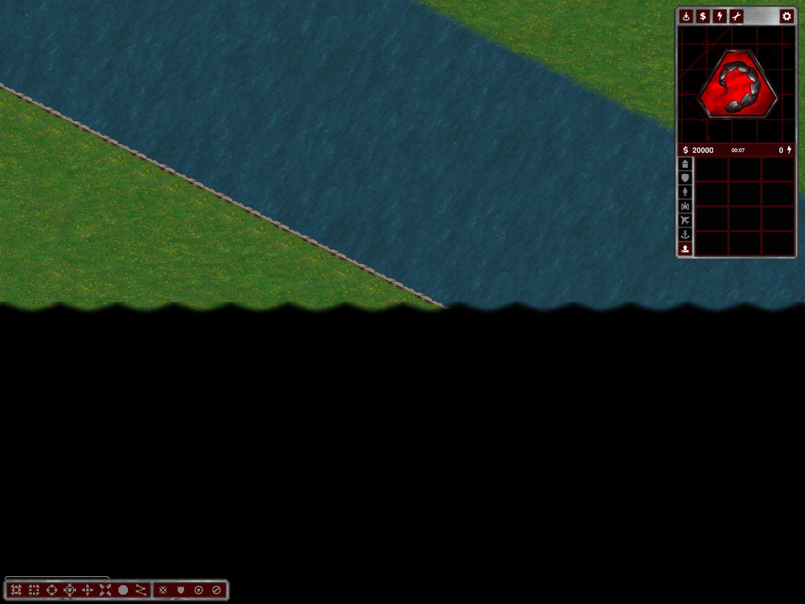
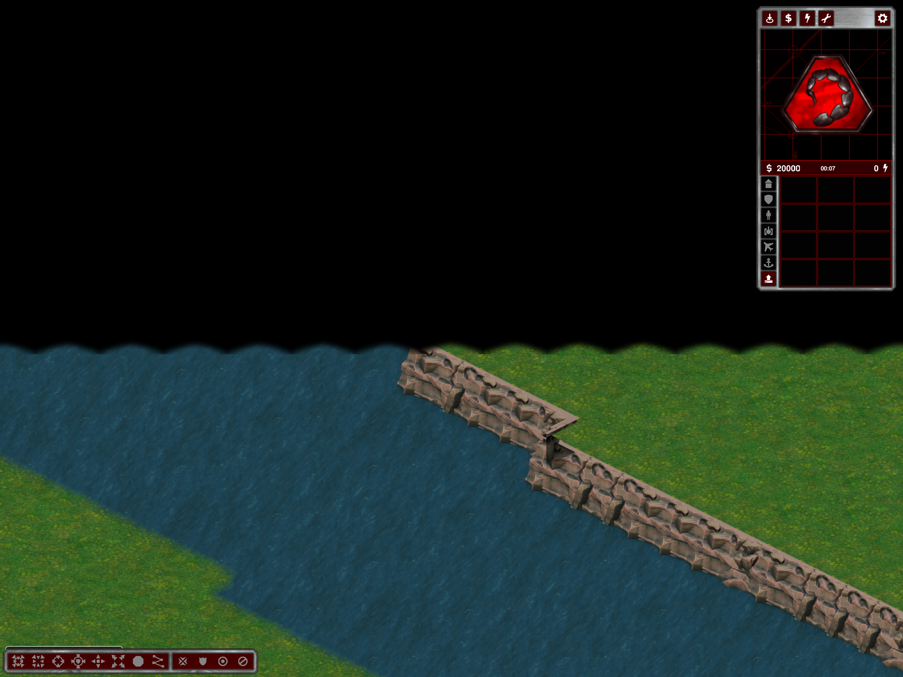

# Two Sides: coast walls reach the map edge

Follow-up to [continuous coasts](two-sides-continuous-coasts.md).

- Removed the four-cell boundary exclusion for continuous Two Sides banks.
- The shared coast planner can clip footprints **outside the playable bounds only**. In-map water depth, resources, actor protection, land/water connectivity and landing checks remain mandatory.
- Boundary exits have no artificial end pile. Both defensive runs must reach the boundary and have exactly one interior end; the exporter rejects incomplete layouts.
- A preflight using the actual coast planner runs before accepting a Two Sides layout in all three modes. Failed complete layouts retry deterministically. This is necessary: extending some old layouts would isolate a small boundary land cell. No water is filled and no isolated cell is hidden or silently erased. Consequently an existing seed can select a later generation attempt and produce a different layout.
- Rear end aliases and the rear convex pile (slot 28) now use the same narrow bank band as the rear crest. Original PNGs remain unchanged; front-facing interior end piles are unchanged.
- Editor recovery supports previous and boundary-clipped actor/footprint families. Extensions preserve the new style; history retains exact old actors.
- The debug generator now initializes the active mod before rule-backed preflight, matching the other generation utilities.

## Evidence

Release build and `git diff --check` passed.

- `--two-sides-test`: 36 twice-generated Strategic cases, 2–12/16 players.
- `--two-sides-coast-test`: eight exports, two boundary-reaching runs each, every native bank face present. Negative controls reject protected bank cells and an in-map second water row replaced with land, even with edge clipping enabled.
- Tactical and Operational 4P/1226359626 exports passed; additional Tactical seed 45 exported successfully.
- Actual normal-tileset client 4P/1226359626: rear-end, rear-edge and front-edge captures inspected. Twelve autonomous objective visits completed by tick 1331.
- Actual naval client: four docks, eight productions, sixteen reciprocal route legs passed.
- Actual editor: both boundary components passed exact removal/Undo/Redo and terrain/resource/actor save/reload.
- Additional seed-45 low rear-end capture inspected. Both captured layouts use rear direction 3; this is not visual acceptance of every orientation or corner.

Evidence is under `%TEMP%/ymca-edge-coasts/`: `final-matrix`, `play`, `end`, `edge`, `front-edge`, `editor`, `naval`, `tactical`, `operational`, `direction45`, and result pointers. Early matrix failures led to whole-layout preflight rather than weakened connectivity. An initial debug-command missing-mod failure was fixed. The failed seed-43 capture used incompatible diagnostic starting factions and is not acceptance; the later isolated fixture uses matching player definitions.

Shaded/all-direction visual acceptance, a fresh long soak and multiplayer fairness are outside these checks. Restart and regenerate Two Sides. No commit or push performed.
