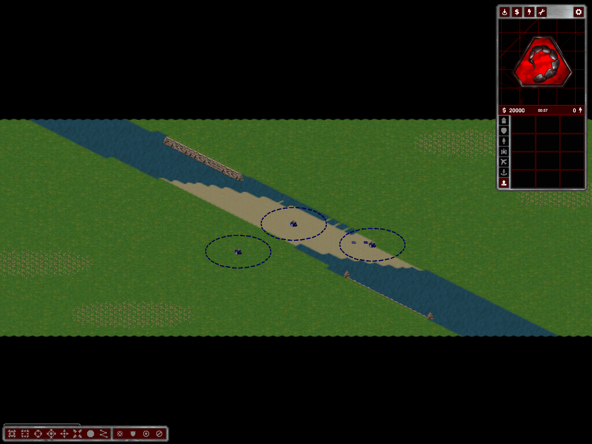

# Two Sides: wider river/causeway, centered objective, ground joins

Follow-up to [Two Sides feedback](two-sides-feedback.md). The subsequent
[continuous coast update](two-sides-continuous-coasts.md) supersedes the straight-only rear-cliff scope below. Local changes;
restart and regenerate to obtain the new layout and bank-aligned rear actors.

## Layout

- Causeway radius: `Clamp(size / 32, 4, 6)` instead of `Clamp(size / 48, 2, 4)`.
  At the automatic four-player 96x96 size this doubles the nominal radius.
- River-width parameter: `Clamp(size / 9, 10, 18)` instead of
  `Clamp(size / 11, 8, 14)`. At 96x96 the channel is nominally 25% wider.
  Rasterization and bends still affect the exact local width.
- For odd checkpoint counts, select the central FCOM nearest the causeway's
  physical centroid, accounting for the native 2x3 footprint and its
  `LocalCenterOffset: 0,-512,0`. All six footprint/approach cells must lie on
  the existing sand crossing. Route both banks through that anchor and require
  the ordered-chain DP to use it at the middle hierarchy. No objective grass
  pads or resource deletion. Infeasible complete layouts retry.

## Sand/grass

The visible rectangular teeth were baked into old square-neighborhood autotile
IDs 1120–1139 and 1304–1307, not caused by the new water/grass shoreline masks.
The exporter now retains the original grass cells instead of inserting these
sand-containing Clear tiles. Runtime/editor recognize legacy IDs as grass and
cover their baked sand with grass while retaining IDs and physical terrain.
The same native material layer then draws the join. A legacy-map client capture
also confirms the teeth disappear without rewriting its terrain.

Dry grass/sand joins reuse the existing authored sand silhouette, including its
safe diagonal cases. Neither the source atlas nor the water/grass composition
algorithm was changed. All 24 legacy IDs/variants have the same terrain type as
grass in both tilesets (checked). The complete dry-join cache adds 80 possible
frames: 704 ground + 1152 water + 15 apron frames require at most five 2048-square
RGBA sheets (80 MiB) when both water families are fully precached. Ordinary
single-family maps do not require this complete worst-case allocation.

## Rear cliffs — deliberately scoped

Whole **straight rear-facing components** now use six `.bank` sequence aliases
with shared runtime/editor `RockCoastBody` projection. Align the original short
family roof to the native bank edge (64px Y correction), retain the authored lip,
and clip the interior behind the land plane. Limit the visible face to its
native edge span. No PNG pixel, map height, water cell or collision edit.

Front faces, end piles and corner-containing components keep their existing
socket family. We do not mix the new and old anchors within a joined component.
This is **not** a claim that every cliff corner or mountain contour is visually
finished. Rear slices share a weak, sprite-keyed cache and cannot retain old maps.

## Evidence

Final wider-river evidence: `%TEMP%/ymca-wide-river/`.

- Release build passes; 36 twice-generated player/seed cases pass, including
  centered odd-count objectives, full sand footprint and unchanged terrain/
  economy during checkpoint placement.
- User seed 1775378146, four players: two accepted coast runs; actual client
  completes all 12 autonomous checkpoint visits at tick 1410.
- Actual naval client: four docks, eight productions, sixteen reciprocal legs.
- Shaded editor: brush, exact Undo/Redo and save/reload pass; 920 authored shore
  sprites/two sheets plus the complete 704/1152/15 material-cache check pass.
  Its results pointer remains under `%TEMP%/ymca-wide-causeway/editor-shaded/`.
- Coast fixture export checks 256 rear roof/bank column alignments and original
  source crops. Client close-up coverage here is the user's NE rear run, not an
  all-corner visual acceptance matrix.
- Export binary audit contains none of the old grass/sand autotile IDs.
- The first full material-cache diagnostic hit the old four-sheet bound; that
  failed run is not acceptance. The bounded five-sheet complete-cache run passes.

[Sand/grass close-up](images/two-sides-wide-river-detail.png) ·
[Rear rim close-up](images/two-sides-wide-river-rear.png)

Remaining: user visual review, broader corner/seed/options coverage and full
match fairness. No new full-match, networking or long-soak claim.
