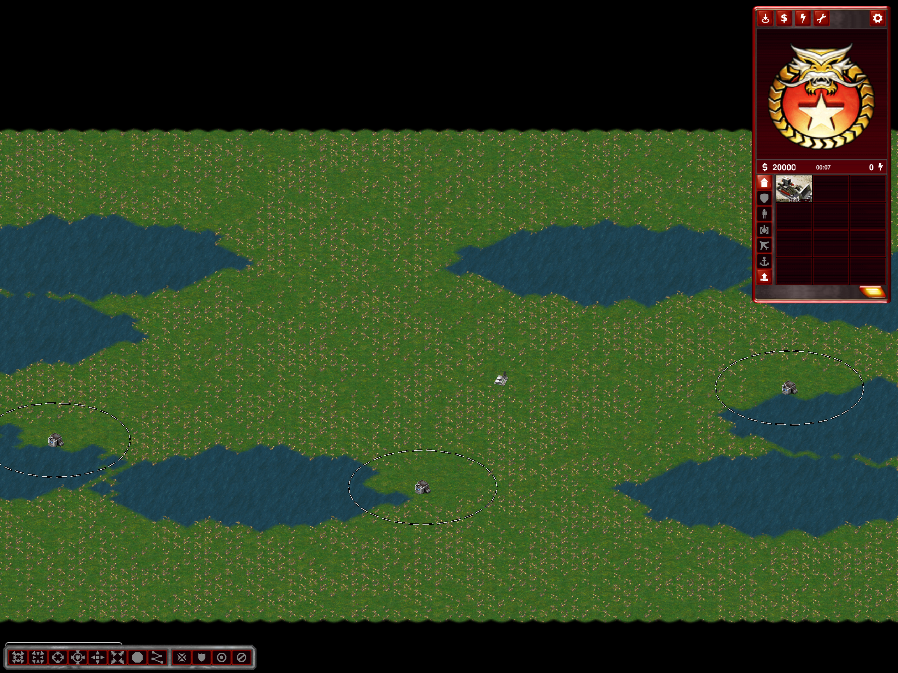

# Water Basins: open inland shores

Water already provides the preset's obstacles and crossings. Additional blocked rock banks are no longer selected by `RubberduckCoastTopology.Mark` for Water Basins. Smoothing and player/land-component/water-component landing reservations remain. This changes physical generation, not merely actor visibility: new exports contain no coast actors, blocked bank tiles or blocked-water cliff feet.

Other presets retain their coast policy, including the approved Two Sides defensive banks. Saved maps are not silently rewritten; regenerate Water Basins to obtain open shores. Resource scattering can use former cliff reservations, so exact old resource placement is not promised.

Validation:

- Isolated Release build passed while the user's running client was left untouched.
- `--water-basins-shore-test OUTPUT`: 24 layouts and physical exports; Tactical/Operational/Strategic, 2/4/8/16 players, seeds 42/43. Existing generation/gameplay validators ran. Tests require basin water and landing reservations, no planned cliff banks/mountains, zero exported heights, no cliff/bank tiles and no coast actors.
- Strategic 4P/42 before/after: exact water footprint preserved, counting old blocked-water feet as water.
- Actual isolated client screenshot inspected: open grass shores, no rock walls. This is generation/visual acceptance, not a new naval, multiplayer or balance acceptance.

Evidence: `%TEMP%/ymca-open-basins` (build/matrix/client logs, baseline, exports, screenshot and preservation assertion). Changes remain local/uncommitted. Normal binaries were subsequently updated after the user client closed. The later [Strategic front correction](water-basins-strategic-front.md) supersedes the old Strategic layout/footprint equivalence; the open-shore policy remains.
