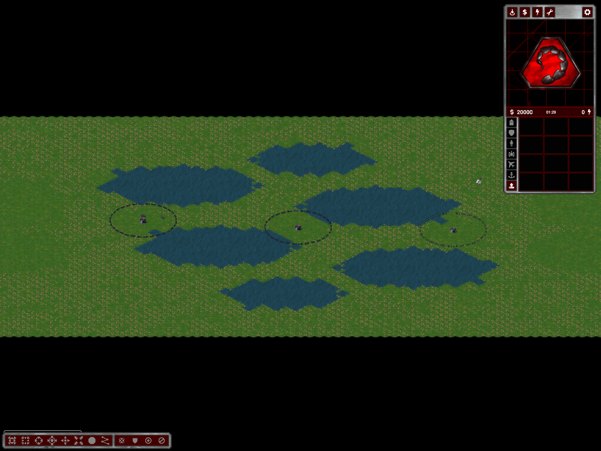

# Water Basins: route-aware Strategic starts and objectives

The old front was sampled along an unweighted path between *average team positions*. That did not compare any individual home's detour around water. Additional circular FFA starts also had different depths relative to the front.

Only Strategic Water Basins now uses two separated home columns (20 map rows between homes) and twofold basin placement/smoothing. Tactical/Operational retain their previous starts and water-generation policy. Two Sides, Hill Fortress and Arabia are unaffected by this front policy.

`WaterBasinsStrategicPlanner` reserves the entire objective chain before resources and tech buildings. Candidate pads cover the native 2x3 FCOM footprint plus approaches and must already be dry land outside home build clearances. No terrain is filled and no placed resources are erased to rescue an objective. Economy placement honors reservations. Small custom maps that cannot fit separated home rows fail explicitly.

For each home, Dijkstra measures native eight-neighbor walking distance (1000/1414 weights; no diagonal corner cutting). A bounded deterministic search selects separated pads, requiring:

- home-to-own-first-command distances within 20% plus one native-cell discretization allowance;
- the same bound for all homes to the central command when the chain has an odd count;
- increasing distance to every successive command from each first-team home and decreasing distance from each second-team home;
- complete-layout rejection/retry if no valid chain fits.

This is a geometric ground-route bound, not a claim of identical unit travel times or full multiplayer balance. Actors, traffic, capture radii and unit behavior can still affect timing. Even-count chains have no single central-objective constraint.

## Evidence

Independent shortest-path measurements on saved/exported `map.bin` files, same native weights, origin-to-origin, player order 0–3:

| User seed | Before | After |
|---|---|---|
| 569840303 | 44.9 / 29.9 / 34.0 / 36.7 | 27.2 / 29.6 / 28.4 / 28.4 |
| 1210425892 | 47.0 / 28.9 / 47.0 / 32.9 | 28.4 / 28.4 / 28.4 / 28.4 |
| 1983607703 | 60.7 / 26.6 / 42.5 / 31.5 | 22.7 / 22.7 / 24.6 / 25.1 |

- `--water-basins-shore-test OUTPUT`: 72 generated/exported layouts; all three modes, 2–12 and 16 players, seeds 42/43. Open-shore checks, existing gameplay validators and Strategic route/reservation validation pass. Negative reversed-chain and flooded-pad cases are rejected without filling water. Repeated 4P/42 starts/objectives match.
- Actual client, 4P/569840303: all twelve autonomous objective visits complete at tick 2217, using the same Challenger unit type from all four homes. Teams are tested in consecutive phases, so absolute logged ticks must not be compared directly between teams.
- Source-level Release build and normal installed build pass. Actual screenshot inspected.

Evidence: `%TEMP%/ymca-basin-front` (`full-matrix.log`, `route-comparison.txt`, three `user-*` exports, `play-final` results pointer, screenshot and build logs). The initial quarter-turn/FFA-style attempts were superseded by this two-team policy. It intentionally changes the generated layout, starts, water and economy placement; the earlier open-shore-only water-footprint equivalence is not a promise for this update. No saved user maps were overwritten.

Restart and regenerate Water Basins. Changes remain local/uncommitted/unpushed. No new long soak, naval runtime matrix or complete multiplayer balance/victory acceptance is claimed.
